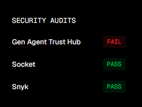

# Historia czatu — dzień 2, 5 listopada 2026

Wiadomości publiczne w kolejności chronologicznej. Reakcje oznaczają zliczenia przy wiadomościach, nie rozłączne głosy ani liczbę uczestników.

## Wiadomości

- **09:01 — T.K.:** nasz github szkoleniowy - https://github.com/LucasMatuszewski/jsystems-codex-2026-11

- **09:02 — Łukasz Matuszewski:** Podsumowania każdego dnia i hostoria chata:  
  https://github.com/LucasMatuszewski/jsystems-codex-2026-11/tree/main/course-materials/zoom-summary-chat-history

- **09:05 — Łukasz Matuszewski:** Polska wersja gry Terry Pratchet Świat Dysku  
  https://01a1a77e-f6c8-7932-b201-3b139a9b8bbb.arena.site/

- **09:10 — T.K.:** Czy znasz skile które:  
  1 modyfikują specyfikację na bardziej tokenową (mniej ludzką ale skuteczną w rozumieniu i ilości tokenów)  
  2 dla bezpieczeństwa jak ten od Nvidia do skanowania skili

- **09:17 — Łukasz Matuszewski:** New Version Control zamiast Git, lepszy pod agentów  
  https://www.anthropic.com/research/redesigning-source-control

- **09:19 — Łukasz Matuszewski:** TODO:personalizacja - pamięć codexpersonalizacja - na poziomie konta, organizacji, projektu - Instrukcje Codex i ChatGPTKonfiguracja - Codex Sandbox: read & write + internetGłos - język domyślny, głos + NOWOŚĆ: słownik własnych wyrażeńOgólne - środowisko Agenta: Windows vs WSL. Oraz Terminal: PowerShell vs Git Bash vs WSL

- **09:37 — Łukasz Matuszewski:** Be casual, not formal, but still professional.  
  Be concise! Provide short answers unless I ask for more details. I prefer step-by-step instructions that are straight to the point. Never repeat the same information.  
  You may provide your opinions on topics but always make it clear that this is your opinion, not a fact. When you don't know, just say that you don't know.

- **09:42 — Łukasz Matuszewski:** I prefer YAGNI and KISS over DRY. The best coat is the coat that was never written.

- **10:00 — Łukasz Matuszewski:** codex doctor  
  w razie problemów z konfiguracją

- **10:10 — Łukasz Matuszewski:** na wirtualkach w PS  
  gh auth login

- **10:10 — Łukasz Matuszewski:** gh auth login

- **10:14 — Łukasz Matuszewski:** https://github.com/settings/personal-access-tokens/new

- **10:15 — Łukasz Matuszewski:** https://github.com/settings/personal-access-tokens

- **10:20 — T.K.:** Swojemu prywatnemu nie daję możliwości pracy na gicie. Tylko lokalnie może coś zrobić ale pushe robię ja. Kiedyś uznał że moje ręczne poprawki nie są jego zmianami i je zaorał... Może przyda się na pełnoagentowych.

- **10:21 — Łukasz Matuszewski:** ActionsRead-only  
  VariablesRead and write  
  ContentsRead and write  
  MetadataRead-only  
  Pull requestsRead and write

- **10:23 — Łukasz Matuszewski:** git worktree

- **10:25 — Łukasz Matuszewski:** ? Paste your authentication token: ***********************************- gh config set -h github.com git_protocol https  
  ✓ Configured git protocol  
  ✓ Logged in as LucasMatuszewski

- **10:27 — Łukasz Matuszewski:** sprawdź czy ma dostęp do gh cli

- **10:28 — Łukasz Matuszewski:** ustaw git configs with user name and email based on gh cli data

- **10:29 — Łukasz Matuszewski:** na dysku D: skolnuj gh repo do którego masz dostęp ze szkolenia codex

- **10:41 — Łukasz Matuszewski:** I installed GitHub CLI here, and it's already authenticated for my user. But the sandbox built into Codex will block you, so I would like you to modify your sandbox settings or explain exactly where I should make the change so I can unblock access to my token, because at the moment, this token may be inaccessible to you. So try first to modify your settings yourself so you can use this GitHub CLI.

- **10:42 — Łukasz Matuszewski:** Can you add this tool to the exceptions so the sandbox doesn't block it? Is there an allowlist, for example, so that in the future, data collection, checking an account, or checking a pool, but not everything from GitHub, just the least risky things, is allowed outside the sandbox?  
  Add some information at the user level in the AGENTS.md file for Codex so that you remember in the future how to use GH outside the sandbox, so that you no longer claim that you are not logged in and immediately know how to use it.

- **10:52 — Łukasz Matuszewski:** You added unnecessary instructions to the general AGENTS.md files here on disk D, directly in ruTeDisc D, and to the user catalog. Remember that there are files used by all agents, and these instructions only concern the code, so remove them from there. They are not needed at this level of detail for other agents. In these files, you can write only one short sentence saying that GH is available and authenticated. Nothing more.

- **10:52 — Łukasz Matuszewski:** The instructions you added to your Codex AGENTS.md file are too detailed. Remember that you are well-versed in Tailwind. Remove everything that is obvious to you, all information that you already have built into your knowledge and that you do not need to repeat here. Make it at least 50% shorter, leaving only the things that are really needed by every agent every time they work on a project.

- **11:04 — Łukasz Matuszewski:** /resume  
  pokazuje wszystkie sesje i pozwala do nich wrócić

- **11:05 — Łukasz Matuszewski:** w desktop:  
  shift+ctrl+p

- **11:05 — Łukasz Matuszewski:** wyszukiwanie pełne

- **11:08 — Łukasz Matuszewski:** 2x esc  
  tryb transkrypcji

- **11:10 — Łukasz Matuszewski:** esc kolejny wychodzi z transkrypcji

- **11:12 — Łukasz Matuszewski:** micro = lepsze nano

- **11:12 — Łukasz Matuszewski:** micro edytor kodu prosty

- **11:13 — Łukasz Matuszewski:** https://micro-editor.github.io/  
  $EDITOR=micro

- **11:17 — Łukasz Matuszewski:** ctrl + g  
  otwiera prompt w dowolnym edytorze  
  polecam CLI/TUI

- **11:20 — Łukasz Matuszewski:** Przykład $EDITOR dla bash  
  https://github.com/LucasMatuszewski/jsystems-codex-2026-11/blob/main/course-materials/agent-configs/.bashrc-agents

- **11:21 — Łukasz Matuszewski:** koniec przerwy 11:35

- **11:36 — Łukasz Matuszewski:** esc - zatrzymanie agenta

- **11:40 — Łukasz Matuszewski:** https://github.com/LucasMatuszewski/jsystems-codex-2026-11  
  Analyze the repository from a security perspective to see whether there are any dangerous things for agents, such as prompt injection techniques. Use code mode scripts here to analyze the entire repository, searching for characteristic elements of prompt injection, instead of reading each file separately. Just run this script here to search for them.

- **11:41 — Łukasz Matuszewski:** https://chatgpt.com/

- **11:42 — Łukasz Matuszewski:** Wyszukiwarka Skills:  
  https://www.skills.sh/

- **11:45 — Łukasz Matuszewski:** https://www.skills.sh/mattpocock/skills/grill-with-docs

- **11:45 — Łukasz Matuszewski:** https://www.skills.sh/mattpocock/skills/tdd

- **11:46 — Łukasz Matuszewski:** https://www.skills.sh/anthropics/skills/frontend-design

- **11:47 — Łukasz Matuszewski:** DDD  
  https://www.skills.sh/codewithmukesh/dotnet-claude-kit/ddd

- **11:50 — T.K.:** Wstępny audit...  
  

- **11:52 — T.K.:** 3/5 analitycznych publicznych skilli wyciąga .env z tokenem 😄 warto je skanować

- **11:59 — Łukasz Matuszewski:** https://github.com/juliusbrussee/caveman

- **12:00 — Łukasz Matuszewski:** Oszczędność tokenów

- **12:08 — Łukasz Matuszewski:** Caveman  
  https://www.skills.sh/juliusbrussee/caveman/caveman

- **12:11 — Łukasz Matuszewski:** Ponytail  
  https://www.skills.sh/dietrichgebert/ponytail/ponytail  
  https://github.com/dietrichgebert/ponytail

- **12:14 — Łukasz Matuszewski:** cd D:\jsystems-codex-2026-11\

- **12:19 — Łukasz Matuszewski:** npx skills add https://github.com/dietrichgebert/ponytail --skill ponytail

- **12:22 — Łukasz Matuszewski:** https://www.skills.sh/

- **12:26 — Łukasz Matuszewski:** https://github.com/EdukeyTeam/agent-toolbox  
  Skills moje

- **12:34 — Łukasz Matuszewski:** LEGACY  
  https://github.com/EdukeyTeam/agent-toolbox/tree/main/skills/legacy-codebase-workflows

- **12:38 — Łukasz Matuszewski:** npx --yes skills@latest add EdukeyTeam/agent-toolbox

- **12:45 — Łukasz Matuszewski:** https://www.skills.sh/edukeyteam/agent-toolbox

- **12:46 — Łukasz Matuszewski:** https://www.skills.sh/edukeyteam/agent-toolbox/create-design-system

- **12:51 — Łukasz Matuszewski:** $nazwa-skilla  
  ręczne użycie skills

- **12:51 — Łukasz Matuszewski:** $create-design-system

- **12:56 — Łukasz Matuszewski:** Use the Playwright tool, showing the Chrome profile normally so I can see what you're doing.

- **12:58 — Łukasz Matuszewski:** https://chromewebstore.google.com/detail/playwright-extension/mmlmfjhmonkocbjadbfplnigmagldckm

- **12:58 — Łukasz Matuszewski:** https://github.com/ChromeDevTools/chrome-devtools-mcp/blob/main/docs/cli.md

- **12:58 — Łukasz Matuszewski:** https://github.com/ChromeDevTools/chrome-devtools-mcp/tree/main

- **13:10 — Łukasz Matuszewski:** 13:40 koniec przerwy

- **13:12 — Łukasz Matuszewski:** https://docs.unity3d.com/Packages/com.unity.ai.assistant@2.0/manual/unity-mcp-overview.html

- **13:14 — Łukasz Matuszewski:** 3D engine dla gier w Web od Microsoft  
  https://www.babylonjs.com/

- **13:15 — Łukasz Matuszewski:** REA - Reverse Engineer Anything  
  https://github.com/morluto/rea

- **13:16 — Łukasz Matuszewski:** https://bf1942.pieter.com/

- **13:17 — Łukasz Matuszewski:** https://doom.pieter.com/

- **13:18 — Łukasz Matuszewski:** Koniec przerwy 13:40

- **13:30 — T.K.:** Odpalenie z uprawnieniami załątwiło sprawę. pewnie nie miał domyślnie po pobraniu repo w comandline a nie z jego chata:  
  codex -C D:\jsystems-codex-2026-11 --sandbox danger-full-access --ask-for-approval on-request --no-daemon  
  $create-design-system https://www.x-kom.pl/ użyj Playwright i pokaż widoczny Chrome

- **13:44 — B.N.2:** udostepnisz ekran ?

- **13:44 — B.N.2:** dzieki :)

- **13:47 — Łukasz Matuszewski:** codex -C D:\jsystems-codex-2026-11 --sandbox danger-full-access --ask-for-approval on-request --no-daemon

- **13:49 — Łukasz Matuszewski:** tmux

- **13:49 — Łukasz Matuszewski:** https://github.com/tmux/tmux/wiki

- **13:52 — Łukasz Matuszewski:** $create-design-system https://www.x-kom.pl/ użyj Playwright i pokaż widoczny Chrome

- **13:53 — Łukasz Matuszewski:** codex -C D:\jsystems-codex-2026-11 --sandbox danger-full-access --ask-for-approval on-request

- **13:53 — Łukasz Matuszewski:** $create-design-system https://www.x-kom.pl/ użyj Playwright i pokaż widoczny Chrome

- **13:57 — Łukasz Matuszewski:** --sandbox danger-full-access  
  wyłączenie sandboxa

- **13:59 — Łukasz Matuszewski:** https://restic.net/  
  BACKUPS

- **14:16 — Łukasz Matuszewski:** https://pieter.com/

- **14:17 — Łukasz Matuszewski:** https://x.com/levelsio  
  Indie dev multimilioner, bootstraping

- **14:21 — T.K.:** nie wiem jak wy, jeszcze walczę z PR bo zgubił znów klucz do gita

- **14:22 — T.K.:** The token in default is invalid.  
  Dodatkowo Windows Credential Manager zwrócił Odmowa dostępu. Dlatego nie mogę wykonać push ani utworzyć PR.

- **14:27 — Łukasz Matuszewski:** sandbox_mode = "danger-full-access"

- **14:27 — Łukasz Matuszewski:** D:\AI\labuser\.codex\config.toml

- **14:28 — Łukasz Matuszewski:** [sandbox_workspace_write]  
  network_access = true

- **14:36 — Łukasz Matuszewski:** https://github.com/LucasMatuszewski/jsystems-codex-2026-11/blob/main/course-materials/Prompt%20examples/PRD-electronics-returns-decision-model-app.md

- **14:46 — Łukasz Matuszewski:** AG-UI = UI jako tools dla agentów  
  https://docs.ag-ui.com/introduction

- **14:46 — Łukasz Matuszewski:** https://www.copilotkit.ai/ag-ui

- **14:47 — Łukasz Matuszewski:** https://www.copilotkit.ai/

- **14:48 — Łukasz Matuszewski:** SDK  
  Community: https://github.com/ag-ui-protocol/ag-ui/tree/main/sdks/community

- **14:48 — Łukasz Matuszewski:** https://github.com/ag-ui-protocol/ag-ui/tree/main/sdks

- **14:51 — T.K.:** Ryzyk fizyk robię całkiem co innego 😄 najwyżej nie skończę

- **14:54 — Łukasz Matuszewski:** $write-prd

- **14:57 — Łukasz Matuszewski:** Use an interactive tool to ask questions that I can click on. My answers should influence your next questions and recommendations, with an explanation of why.

- **14:58 — Łukasz Matuszewski:** shift+tab  
  /plan  
  Plan Mode = brak edycji plików, tylko plik z planem

- **15:03 — Łukasz Matuszewski:** shift + strzałka góra/dół  
  zmiana poziomu myślenia

- **15:09 — Łukasz Matuszewski:** Don't use a time counter. Let me answer these questions one by one, so that only after answering the first one does the next one appear.

- **15:11 — Łukasz Matuszewski:** codex update

- **15:14 — Łukasz Matuszewski:** You're too quick to wait for me to answer; this form immediately disappears. You can't add any further answer after you ask me a question. You have to wait after asking me a  
    question because otherwise the form disappears.

- **15:17 — Łukasz Matuszewski:** Inne frameworki Spec Driven Development (SDD):  
  https://specs.md/  
  np. FIRE  
  Spec Kit  
  https://github.com/github/spec-kit

- **15:18 — Łukasz Matuszewski:** skills podobne:  
  PRD https://www.skills.sh/?q=prd  
  ADR https://www.skills.sh/?q=adr  
  Plan https://www.skills.sh/?q=plan  
  SDD https://www.skills.sh/?q=sdd  
  Spec https://www.skills.sh/?q=spec

- **15:18 — Łukasz Matuszewski:** You're too quick to wait for me to answer; this form immediately disappears. You can't add any further answer after you ask me a question. You have to wait after asking me a  
    question because otherwise the form disappears.

- **15:19 — Łukasz Matuszewski:** Use an interactive tool to ask questions that I can click on. My answers should influence your next questions and recommendations, with an explanation of why.

- **15:35 — Łukasz Matuszewski:** /docs/PRD.md  
  w katalogu projektu / repo szkolenia:  
  D:\jsystems-codex-2026-11

- **15:38 — Łukasz Matuszewski:** Remember that we're on a proof of concept. When it comes to delegating to an employee, for now, do it as an auto-scope, just a preliminary recommendation from the agent. We'll build a module later that will pass this recommendation to the person in customer service. For now, let it be just a chat for the client as a proof of concept.

- **15:38 — Łukasz Matuszewski:** ctrl + w  
  kasowanie słów

- **15:39 — Łukasz Matuszewski:** enter = stear mode domyślnie (sterowanie)

- **15:39 — Łukasz Matuszewski:** tab = queue / kolejka

- **15:42 — Łukasz Matuszewski:** https://context7.com/  
  Tool do docs i repo

- **15:42 — Łukasz Matuszewski:** RAG

- **15:48 — Łukasz Matuszewski:** Context7 local RAG na własnych docs i repo:  
  https://github.com/EdukeyTeam/agent-toolbox/blob/main/skills/legacy-codebase-workflows/references/private-retrieval.md  
  https://github.com/EdukeyTeam/agent-toolbox/blob/main/skills/legacy-codebase-workflows/references/local-context7-setup.md

- **15:51 — Łukasz Matuszewski:** npx ctx7 setup

- **15:59 — Łukasz Matuszewski:** ! shell mode

- **15:59 — Łukasz Matuszewski:** ! git push origin app-implementation

- **16:01 — Łukasz Matuszewski:** ADR przykład  
  https://github.com/LucasMatuszewski/jsystems-codex-2026-11/blob/main/course-materials/Prompt%20examples/ADR-generation-typescript-vercel-ai-sdk-decisions.md

- **16:03 — Łukasz Matuszewski:** ctrl+g  
  ctrl+v  
  ctrl+s  
  ctrl+q

- **16:04 — Łukasz Matuszewski:** https://openrouter.ai/docs/api_reference/responses/overview (OpenRouter Responses API)

- **16:06 — Łukasz Matuszewski:** Posh and get a ready-made template for a similar application that will best give you the basic elements to create such a chat and operate these LLMs, so that at the start we already have something that provides ready-made elements we'll just adjust to our application.

- **16:06 — Łukasz Matuszewski:** boilerplate

- **16:07 — Łukasz Matuszewski:** We plan to use OpenRouter for both the conversational LLM and one initial decision model: TypeSafe Jev or OpenAI GPT-6 Luna Decisions. Research their current model IDs, image support, typed answers and the appropriate OpenRouter APIs; do not assume they use the same request format as streaming chat or that both have identical capabilities. Start with the official Jev guide, multimodal Decisions guide and Decisions API reference. For answer semantics, read Noul, confidence and the Luna Decisions model page.

- **16:08 — Łukasz Matuszewski:** The key is to open routers already available in my user-level environment variable: OPENROUTER_API_KEY

- **16:08 — Łukasz Matuszewski:** można przeniść do .env

- **16:10 — B.N.:** dzieki

- **16:12 — T.K.:** UPS

- **16:12 — Łukasz Matuszewski:** https://github.com/LucasMatuszewski/jsystems-codex-2026-11/blob/main/course-materials/Prompt%20examples/ADR-generation-typescript-vercel-ai-sdk-decisions.md

- **16:12 — Łukasz Matuszewski:** Prompt do stworzenia planu:  
  https://github.com/LucasMatuszewski/jsystems-codex-2026-11/blob/main/course-materials/Prompt%20examples/Plan-SubAgents-matrix-dependency-map-LUNA.md

- **16:14 — Łukasz Matuszewski:** $write-adr

- **16:14 — Łukasz Matuszewski:** Plan

- **16:15 — Łukasz Matuszewski:** /goal implement the plan from file @docs/plan.md

- **16:15 — Łukasz Matuszewski:** /goal  
  agent pilnujący realizacji celu

- **16:59 — Łukasz Matuszewski:** Use the Bash script as a monitor that will turn the agent back on at hour X and help it continue working toward the goal because our limit will restart at that hour.  
  *Wiadomość edytowana.*

- **16:19 — Łukasz Matuszewski:** /status  
  sprawdzenie kiedy jest restart limitu  
  +10m

- **16:33 — Łukasz Matuszewski:** Nvidia Audio2Face

- **16:33 — Łukasz Matuszewski:** Model AI do generowania animacji do głosu, lipsync

- **16:33 — Łukasz Matuszewski:** https://play.devpowers.com/

- **16:36 — Łukasz Matuszewski:** Gra z WebMCP - nowy standard MCP dla stron.  
  Hackathon OpenAI:  
  https://openai.com/pl-PL/webmcp-challenge/

- **16:43 — Łukasz Matuszewski:** https://developer.chrome.com/docs/ai/webmcp?hl=pl

- **17:16 — Łukasz Matuszewski:** TODO:

  - add instruction in AGENTS.md to always first use Context7, and only search in Web when something could not be found in Context7. In case of CLI tools the first place to search should always be the built-in --help, eg. `gh --help` for specific tools or commands, and context7 if not enough, web as last resort.
  - Poproś o research agenta na etapie ADR, niech pomoże w podjęciu decyzji.
  - test Desktop app with Question mode, it should work better than in CLI right now (hopefully they will fix it soon)
  - Ask to create a Plan with multiple subagents and with Luna and Terra as workers, the orchestrator should decide which model should do which task based on the complexity of the task.
  - Optionaly (in the plan) ask it to delegate to OpenCode in headless mode with Xiaomi MiMo model (it is configured inside OpenCode for you) - plan should provide short instruction how to delegate to opencode in headless mode.
  - Ask for review of the consistency of PRD, ADR and Plan before starting it. Agent should fix any issues first.
  - Optional: remove the instruction to chat in Polish from AGENTS.md if you are comfortable with English or use Handy.computer with translation.
