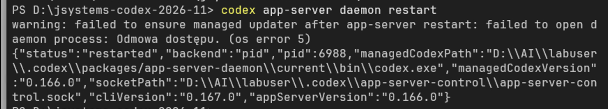
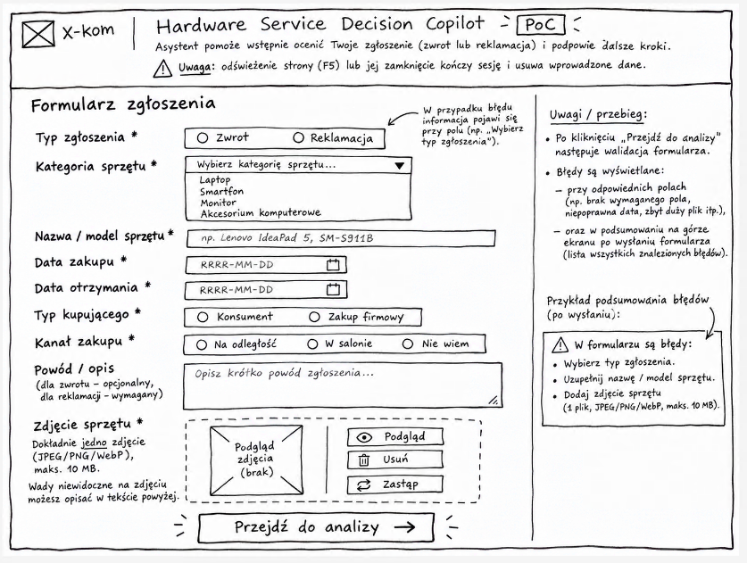
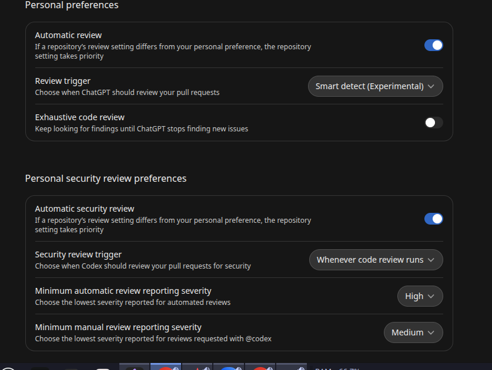

# Historia czatu — dzień 3, 6 listopada 2026

Wiadomości publiczne w kolejności chronologicznej. Reakcje oznaczają zliczenia przy wiadomościach, nie rozłączne głosy ani liczbę uczestników.

## Wiadomości

- **09:06 — Łukasz Matuszewski:** Podsumowania i historia czata z poprzednich dni:  
  https://github.com/LucasMatuszewski/jsystems-codex-2026-11/tree/main/course-materials/zoom-summary-chat-history

- **09:07 — Łukasz Matuszewski:** https://github.com/LucasMatuszewski/jsystems-codex-2026-11/blob/docs/windows-sandbox-workflow/course-materials/agent-configs/codex/WINDOWS-QUICKSTART-PL.md  
  Ustawienia config dla Sandbox

- **09:10 — Łukasz Matuszewski:** course-materials/agent-configs/codex/WINDOWS-QUICKSTART-PL.md

- **09:10 — Łukasz Matuszewski:** https://github.com/LucasMatuszewski/jsystems-codex-2026-11/blob/docs/windows-sandbox-workflow/course-materials/agent-configs/codex/WINDOWS-QUICKSTART-PL.md

- **09:11 — T.K.:** jest update

- **09:18 — Łukasz Matuszewski:** https://chatgpt.com/settings/usage?tab=overview

- **09:23 — Łukasz Matuszewski:** codex app-server daemon restart

- **09:23 — Łukasz Matuszewski:** codex app-server daemon version

- **09:24 — Łukasz Matuszewski:** codex app-server daemon restart

- **09:25 — Łukasz Matuszewski:** codex update

- **09:26 — Łukasz Matuszewski:** powinna być już dzisiaj 0.167.0

- **09:27 — P.B.:** 

- **09:31 — Łukasz Matuszewski:** powershell -ExecutionPolicy ByPass -c "irm https://chatgpt.com/codex/install.ps1 | iex"

- **09:31 — Łukasz Matuszewski:** codex app-server daemon restart

- **09:32 — Łukasz Matuszewski:** codex app-server daemon version

- **09:32 — Łukasz Matuszewski:** CODEX_HOME

- **09:40 — Łukasz Matuszewski:**

  ```toml
  # WARNING: no OS deny-read rules for .env/secrets in this default profile. Never keep real secrets in this course workspace.
  [permissions.course-tools]
  description = "Default course editing: workspace/temp writes, network enabled, no secret-file deny-read; rules allow selected host commands outside the sandbox."
  extends = ":workspace"
  [permissions.course-tools.network]
  enabled = true
  [permissions.course-tools.network.domains]
  "*" = "allow"
  ```

- **09:41 — Łukasz Matuszewski:** default_permissions = "course-tools"

- **09:41 — Łukasz Matuszewski:** około 35 linii

- **09:42 — Łukasz Matuszewski:** https://github.com/LucasMatuszewski/jsystems-codex-2026-11/blob/main/.codex/rules/course.rules

- **09:42 — Łukasz Matuszewski:** https://github.com/LucasMatuszewski/jsystems-codex-2026-11/blob/main/.codex/config.toml

- **09:44 — Łukasz Matuszewski:** sprawdź gh user name is status

- **09:44 — Łukasz Matuszewski:** sprawdź jakie mam repo w gh cli

- **09:46 — Łukasz Matuszewski:** mxc

- **09:47 — Łukasz Matuszewski:**

  ```toml
  [windows]
  sandbox = "elevated"
  # ----------------
  # Feature toggles
  # ----------------
  [features]
  # Tested course baseline; MXC requires a separate acceptance run.
  prefer_mxc = false
  ```

- **09:47 — Łukasz Matuszewski:** `D:\AI\labuser\.codex`

- **09:50 — Łukasz Matuszewski:** codex -C D:\jsystems-codex-2026-11 --sandbox danger-full-access --ask-for-approval on-request

- **09:52 — Łukasz Matuszewski:**

  ```toml
  [windows]
  sandbox = "elevated"
  [features]
  prefer_mxc = false # Use the legacy Windows sandbox selected below/above.
  prevent_idle_sleep = true
  analytics_plan_history = true
  memories = true
  ```

- **09:52 — Łukasz Matuszewski:** `D:\AI\labuser\.codex\config.toml`

- **09:54 — Łukasz Matuszewski:** codex -C D:\jsystems-codex-2026-11 --sandbox danger-full-access --ask-for-approval on-request

- **09:55 — T.K.:** U mnie ADR powstał

- **09:55 — T.R.:**

  Gotowe - trzy ADR ze statusem Proposed:

  - Architektura i wybór startera (docs/ADR/000-main-architecture.md)
  - Decisions, niepewność i reguły polityki (docs/ADR/001-assessment-and-policy.md)
  - Streaming, UI i testy (docs/ADR/002-streaming-chat-and-ui.md)

  Rekomenduję starter assistant-ui, Next.js App Router i AI SDK 7; Luna Decisions przez osobne API oraz Luna do rozmowy i eskalacji. Dokumenty zawierają porównania, źródła, diagramy, kontrakty endpointów, inicjalizację i wymagane live smoke checks.

  Ważna korekta: chat-sdk.dev jest obecnie SDK do botów w komunikatorach.

  Sprawdzenie 13 lokalnych odnośników i diff przeszło. Context7 zweryfikowałem przez CLI, bo MCP nie było dostępne. Nie inicjalizowałem aplikacji ani integracji.

  Zapis .env.example zablokowało środowisko; proponowane zmienne są opisane w ADR. Klucza nie odczytywałem.

- **09:56 — Łukasz Matuszewski:** https://github.com/assistant-ui/assistant-ui

- **09:58 — Łukasz Matuszewski:** https://elements.ai-sdk.dev/

- **09:58 — Łukasz Matuszewski:** Ważna korekta: chat-sdk.dev jest obecnie SDK do botów w komunikatorach.

- **10:02 — M.M.:**

  Ja mam tak:
  Created two proposed ADRs:
  - [Application and streaming chat](D:/labuser/docs/ADR-001-application-and-chat.md)
  - [Decision model and routing](D:/labuser/docs/ADR-002-bounded-decisions.md)
  Recommendation: Next.js + AI SDK + OpenRouter + assistant-ui, with Luna Decisions through a separate adapter.

  Outstanding: Context7 tools weren’t available, and .env.example wasn’t found. Both gaps are documented. No application was initialized or implemented.

- **10:04 — Łukasz Matuszewski:** what is inside .env.example

- **10:05 — M.M.:** There’s no .env.example in D:\labuser currently. The ADR only proposes these contents:  
  OPENROUTER_API_KEY=  
  OPENROUTER_CHAT_BASE_URL=https://openrouter.ai/api/v1  
  OPENROUTER_DECISIONS_URL=https://openrouter.ai/api/alpha/decisions  
  OPENROUTER_CHAT_MODEL=  
  OPENROUTER_VISION_MODEL=  
  OPENROUTER_DECISION_MODEL=openai/gpt-6-luna-decisions  
  DECISIONS_TIMEOUT_MS=30000  
  VISION_TIMEOUT_MS=60000  
  EXPLANATION_TIMEOUT_MS=30000  
  ASSESSMENT_TIME_ZONE=Europe/Warsaw  
  The key stays blank in the example; real credentials belong in an ignored local environment file.

- **10:06 — Łukasz Matuszewski:** cd D:\jsystems-codex-2026-11\

- **10:06 — T.K.:** https://github.com/CoreLogick/jsystems-codex-2026-11/tree/main/docs/ADR

- **10:07 — T.K.:** .env.example zawiera dwa puste ustawienia:  
  OPENROUTER_API_KEY=  
  LLM_MODEL=

- **10:13 — Łukasz Matuszewski:** Przykład dla Angular i Java:  
  https://github.com/LucasMatuszewski/jsystems-codex-2026-11/blob/main/course-materials/Prompt%20examples/ADR-generation-java-openai-sdk-angular-material.md  
  *Wiadomość edytowana.*

- **10:12 — Łukasz Matuszewski:** ADR dla Next.js i Vercel AI SDK  
  https://github.com/LucasMatuszewski/jsystems-codex-2026-11/blob/main/course-materials/Prompt%20examples/ADR-generation-typescript-vercel-ai-sdk-decisions.md

- **10:14 — Łukasz Matuszewski:** Use Angular and Angular Material for FE and Web app. Search for ready to use components to implement chat UI and maybe also streaming from our BE that is ready to use for Angular Material.

- **10:17 — Łukasz Matuszewski:** Sprawdź czy w ADR mamy znaleziony i wybrany Boilerplate zawierający obsługę dla AI-SDK + dowolny framework FE jaki wybraliśmy + obsługa streaming i podstawowych komponentów UI dla chat (z AI Elements lub Assistant-ui, lub innych które wybraliśmy)

- **10:22 — Łukasz Matuszewski:** Mój PRD, ADR i Plan  
  https://github.com/LucasMatuszewski/jsystems-codex-2026-11/tree/feature/hardware-service-copilot/docs

- **10:23 — Łukasz Matuszewski:** TODO na końcu:  
  https://github.com/LucasMatuszewski/jsystems-codex-2026-11/blob/main/course-materials/zoom-summary-chat-history/day-2-chat-history.md

- **10:24 — Łukasz Matuszewski:** add instruction in AGENTS.md to always first use Context7, and only search in Web when something could not be found in Context7. In case of CLI tools the first place to search should always be the built-in --help, eg. gh --help for specific tools or commands, and context7 if not enough, web as last resort.  
  Poproś o research agenta na etapie ADR, niech pomoże w podjęciu decyzji.  
  test Desktop app with Question mode, it should work better than in CLI right now (hopefully they will fix it soon)  
  Ask to create a Plan with multiple subagents and with Luna and Terra as workers, the orchestrator should decide which model should do which task based on the complexity of the task.

- **10:24 — Łukasz Matuszewski:** Optionaly (in the plan) ask it to delegate to OpenCode in headless mode with Xiaomi MiMo model (it is configured inside OpenCode for you) - plan should provide short instruction how to delegate to opencode in headless mode.  
  Ask for review of the consistency of PRD, ADR and Plan before starting it. Agent should fix any issues first.  
  Optional: remove the instruction to chat in Polish from AGENTS.md if you are comfortable with English or use Handy.computer with translation.

- **10:29 — Łukasz Matuszewski:** Use Angular and Angular Material for FE and Web app. Search for ready to use components to implement chat UI and maybe also streaming from our BE that is ready to use for Angular Material.  
  Research and explain in ADR the best way to initialize this project - remember: we start from an EMPTY app and the agent will initialize the template only after the plan is approved. State the initialization command in the ADR, but do not run it now.  
  Research and choose/recommend best starting Boilerplate zawierający obsługę dla AI-SDK + Angular + obsługa streaming i podstawowych komponentów UI dla chat (np. z AI Elements lub Assistant-ui, lub innym jaki rekomendujesz dla Angular)

- **10:32 — Łukasz Matuszewski:** add instruction in AGENTS.md to always first use Context7, and only search in Web when something could not be found in Context7. In case of CLI tools the first place to search should always be the built-in --help, eg. gh --help for specific tools or commands, and context7 if not enough, web as last resort.

- **10:34 — Łukasz Matuszewski:** Context7 best

- **10:35 — Łukasz Matuszewski:** jeśli nie:  
  Every time you do research, search the documentation, or need to find something on the internet, delegate it to an agent who will do the research for you. It can be an agent based on Luna, who will summarize everything for you so you can make a decision. But Luna should not make any decisions; she should only search the internet, collect information, and prepare a detailed summary of everything she has collected about the question you're asking. In other words, you should decide what the research is about, and Luna should only perform this task and provide you with a report. Based on this report, you make a decision. Luna should not do it, because the decision-making model should be Sol.

- **10:55 — Łukasz Matuszewski:** @ai-sdk/angular

- **10:56 — Łukasz Matuszewski:** Poproś o research agenta na etapie ADR, niech pomoże w podjęciu decyzji.

- **10:57 — Łukasz Matuszewski:** Optionaly (in the plan) ask it to delegate to OpenCode in headless mode with Xiaomi MiMo model (it is configured inside OpenCode for you) - plan should provide short instruction how to delegate to opencode in headless mode.

- **11:07 — T.K.:** Pytanie na koniec: wspominałeś o sterowaniu agenta z telefonu. dojdzemy do tego?

- **11:11 — Łukasz Matuszewski:** Koniec przerwy: 11:25

- **11:21 — Łukasz Matuszewski:** Opcja:  
  Usunąć z AGENTS.md zapis o języku polskim

- **11:27 — T.K.:** to course-root czy course-tools

- **11:27 — Łukasz Matuszewski:** [permissions.course-tools]

- **11:32 — Łukasz Matuszewski:** /fork - kopia sesji aby mieć historię w nowej sesji

- **11:32 — Łukasz Matuszewski:** /new - nowa sesja

- **11:33 — Łukasz Matuszewski:** /btw - tymczasowe nowa sesja z historią

- **11:41 — Łukasz Matuszewski:** https://github.com/LucasMatuszewski/jsystems-codex-2026-11/blob/main/course-materials/Prompt%20examples/Plan-SubAgents-matrix-dependency-map-LUNA.md

- **11:42 — Łukasz Matuszewski:** delegate to OpenCode in headless mode with Xiaomi MiMo model (it is configured inside OpenCode for you) - plan should provide short instruction how to delegate to opencode in headless mode.

- **11:44 — Łukasz Matuszewski:** The strong orchestrator makes architectural decisions, resolves contradictions, prepares briefs and accepts results. Prefer cheap small workers for bounded implementation and test-writing: subagent GPT-6 Luna; Delegate also to OpenCode CLI in headless mode with Xiaomi MiMo model (it is configured inside OpenCode for you) - plan should provide short instruction how to delegate to opencode in headless mode.  
  Record the chosen model, provider and budget constraint; escalate when evidence shows the task exceeds the worker's ability. Review and final acceptance stay with a capable model and the human.

- **11:45 — Łukasz Matuszewski:** Pro

- **11:51 — T.K.:** "Dano im szansę rozwoju po za organizacją"

- **11:54 — T.R.:** failed to load AGENTS.md instructions for environment `local`: fs sandbox helper failed with status exit code: 1: windows sandbox failed: helper_unknown_error: setup refresh had errors

- **11:55 — T.K.:** może ta sma sesja w CLI i graficznym

- **12:00 — T.K.:** czy będziemy używać jakiejś licencji na openrouter i wygenerujemy Sobie apikey?

- **12:00 — Łukasz Matuszewski:** OPENROUTER_API_KEY

- **12:04 — Łukasz Matuszewski:**

  ```toml
  # Server-only example model ID: openai/gpt-6-luna-decisions
  DECISION_MODEL=
  ```

- **12:04 — Łukasz Matuszewski:** LLM_MODEL=openai/gpt-6-luna

- **12:04 — Łukasz Matuszewski:** https://openrouter.ai/openai/gpt-6-luna

- **12:05 — Łukasz Matuszewski:**

  ```toml
  # Server-only example model ID: openai/gpt-6-luna-decisions
  DECISION_MODEL=openai/gpt-6-luna-decisions
  ```

- **12:05 — Łukasz Matuszewski:** https://openrouter.ai/openai/gpt-6-luna-decisions

- **12:06 — Łukasz Matuszewski:** Alternatywa:  
  typesafe/jev-1.14  
  https://openrouter.ai/typesafe/jev-1.14

- **12:08 — Łukasz Matuszewski:** Ask for review of the consistency of PRD, ADR and Plan before starting it. Agent should fix any issues first.  
  Optional: remove the instruction to chat in Polish from AGENTS.md if you are comfortable with English or use Handy.computer with translation.

- **12:10 — Łukasz Matuszewski:** For Chat, Reasoning and Repository documentation use English only. Use full Polish diacritics and ASCII punctuation in prose. Use only synthetic data; never read or publish secrets, participant data or customer records.

- **12:13 — Łukasz Matuszewski:** review of the consistency of AGENTS.md, PRD, ADR and Plan before starting it. Agent should fix any issues first.

- **12:14 — Łukasz Matuszewski:** review of the consistency of AGENTS.md, PRD, ADR and Plan. Fix any issues, contradictions, etc.

- **12:15 — Łukasz Matuszewski:** SPEC DRIVEN SDD  
  np.  
  https://specs.md/

- **12:15 — Łukasz Matuszewski:** https://github.com/github/spec-kit

- **12:15 — Łukasz Matuszewski:** https://www.skills.sh/search?q=spec

- **12:21 — Łukasz Matuszewski:** Nowa sesja  
  Permission Allow All - wyłączyć sanbox / Pełen dostęp  
  Sol 6.1 Środni  
  `/goal `  
  implement the plan from `docs\plans\-implementation-plan.md` Make sure that results are fully aligned with PRD, ADR and AGENTS.md instruction

- **12:21 — Łukasz Matuszewski:** W CLI  
  /goal implement the plan from `docs\plans\-implementation-plan.md` Make sure that results are fully aligned with PRD, ADR and AGENTS.md instruction

- **12:24 — T.K.:** Preferuję SOL, słucha co mam do powiedzenia zamiast interpretować po swojemu jak claude

- **12:33 — Łukasz Matuszewski:** https://deepmind.google/blog/genie-3-a-new-frontier-for-world-models/  
  Word Models - generowanei wideo na żywo

- **12:41 — T.K.:** u mnie jeszcze nie ma czego odpalać.

- **12:43 — Łukasz Matuszewski:** /status

- **12:43 — Łukasz Matuszewski:** podajcie o której reset

- **12:44 — Łukasz Matuszewski:** 5h

- **12:44 — T.R.:** 15:05

- **12:44 — T.R.:** 74%

- **12:51 — Łukasz Matuszewski:** .env contains OpenRouter API key and we have there also:  
  LLM_MODEL=openai/gpt-6-luna # Server-only example model ID: openai/gpt-6-luna-decisions / typesafe/jev-1.14 DECISION_MODEL=openai/gpt-6-luna-decisions

- **12:52 — Łukasz Matuszewski:** /subagents w CLI

- **12:53 — Łukasz Matuszewski:** Main zawsze jest, z nim pracujemy

- **13:04 — Łukasz Matuszewski:** $skill-creater

- **13:05 — T.K.:** Ten gdzie puszczaliśmy $write-plan ?  
  Mój się jeszcze kręci...

- **13:08 — Łukasz Matuszewski:** Koniec przerwy 13:40

- **13:09 — Łukasz Matuszewski:** Przed przerwą:  
  Opadlić realizację planu z /goal w nowej sesji  
  w "starej" sesji gdzie tworzyliśmy plan, poproście o stworzenie skilla do tworzenia planów opartego o nasz prompt i instrukcje oraz uwzględniającego ewentualne błędy które popełnił aby w przyszłości agent generujący pln ich uniknął.

- **13:10 — Łukasz Matuszewski:** np. można usunąć`-` z nazwy pliku z planem ;_

- **13:10 — Łukasz Matuszewski:** ;)

- **13:11 — Łukasz Matuszewski:** opcje:  
  elastyczna nazwa pliku  
  dodanie template planu jako osobny plik + np. 2 wersje na różne sytuacje

- **13:21 — Łukasz Matuszewski:** upewnijcie się, że do testów będą używać przykładowych zdjęć z folderu:  
  D:\jsystems-codex-2026-11\assets\example-images

- **13:22 — Łukasz Matuszewski:** Koniec przerwy 13:40

- **13:43 — M.M.:** U mnie koniec limitu :/ Muszę czekać 2h 25

- **13:44 — Łukasz Matuszewski:** w Desktop PL:  
  /stan  
  W CLI:  
  /status

- **13:50 — Łukasz Matuszewski:** We've reached the Codex limit after implementing a plan for the entire application from this repository.  
  I want you to analyze whether you have access to this session from Plikes, find the files for this session, analyze what has been done so far, and prepare to continue this session inside OpenCode so we can finish what Codex has not yet finished.  
  Sesja:  
  01a1b0aa-843f-7411-940b-4604d47ddb57  
  Czat:  
  01a1b0ab-5c2e-7583-bc39-0f80903e7f3f  
  Do not start implementation first; just check everything that was done so far.

- **14:04 — Łukasz Matuszewski:** Mój branch implementacji aplikacji:  
  https://github.com/LucasMatuszewski/jsystems-codex-2026-11/tree/angular-implementation

- **14:04 — T.K.:** tokeny wypalone, wolę kontynuować po resecie 5h dla jakości

- **14:17 — T.K.:** przykład z silnika nad którym pracowałem:  
  1 dodaj przeźroczystość materiału.  
  Done  
  2 dlaczego za przeźroczystym materiałem niczego nie renderujesz  
  O! nie wpadłem na to

- **14:29 — Łukasz Matuszewski:** Vibe Coding apps:  
  https://lovable.dev/  
  https://v0.app/ (działa z ChatGPT subs)  
  https://v0.app/templates  
  https://bolt.new/

- **14:36 — Łukasz Matuszewski:** 

- **14:57 — Łukasz Matuszewski:** https://git-scm.com/docs/git-worktree  
  Git Worktree

- **15:26 — T.K.:** Jaką masz opinię o Cursor?

- **15:32 — Łukasz Matuszewski:** https://github.com/LucasMatuszewski/jsystems-codex-2026-11/tree/main/course-materials/agent-configs/codex/agents  
  Custom Sub-Agents

- **15:35 — Łukasz Matuszewski:** e2e-qa-engineer.toml

- **15:43 — Łukasz Matuszewski:** PLAN KASUJEMY PO REALIZACJI!!!!!

- **15:44 — Łukasz Matuszewski:** BRIEFS też kasujemy po wykonaniu!

- **15:45 — Łukasz Matuszewski:** tree

- **15:45 — Łukasz Matuszewski:** eza - better ls / tree

- **15:57 — T.K.:** warto dawać mu jakiś limit prób/czasu. U mnie wariat popsuł pliki nie związane z funkcjonalnością i próbował ją naprawić w wiecznej pętli go grzebał nie tu gdzie popsuł...

- **15:59 — T.K.:** Mój agent zgłosił:  
  Potrzebna czynność po Twojej stronie  
  Administrator właściwego workspace musi otworzyć:  
  https://openrouter.ai/workspaces/default/guardrails  
  i dopuścić typesafe/jev-1.14 w polityce Model & provider access dla używanego klucza aplikacji. Nie przesyłaj mi wartości klucza.  
  *Reakcje: 👍: 1.*

- **16:00 — Łukasz Matuszewski:** https://github.com/EdukeyTeam/agent-toolbox/tree/main/skills/respond-to-code-review  
  Respond to CR

- **16:01 — Łukasz Matuszewski:** Duże Repo do analizy:  
  https://github.com/EdukeyTeam/agent-toolbox/tree/main/skills/legacy-codebase-workflows

- **16:02 — Łukasz Matuszewski:** https://github.com/EdukeyTeam/agent-toolbox/tree/main/skills/agent-usage-analytics  
  Analiza sesji i danych

- **16:03 — Łukasz Matuszewski:** https://github.com/LucasMatuszewski/jsystems-codex-2026-11/tree/main/course-materials/cicd-headless  
  CI/CD workflows dla agentów

- **16:04 — Łukasz Matuszewski:** PR Agent  
  https://www.qodo.ai/ - komercyjny

- **16:05 — Łukasz Matuszewski:** https://github.com/The-PR-Agent/pr-agent  
  OpenSource

- **16:06 — Łukasz Matuszewski:** https://chatgpt.com/settings/code-review

- **16:07 — Łukasz Matuszewski:**

  ```bash
  claude --bare -p "$REVIEW_PROMPT" \
      --output-format json \
      --max-turns 3 \
      < "$OUTPUT_DIR/pr.diff" > "$OUTPUT_DIR/review.json"
  ```

- **16:07 — Łukasz Matuszewski:** codex exec ....

- **16:09 — Łukasz Matuszewski:** Code review z Codex w GitHub i GitLab w chmurze  
  https://chatgpt.com/settings/code-review

- **16:10 — Łukasz Matuszewski:** 

- **16:11 — Łukasz Matuszewski:** SECURITY.md

- **16:14 — Łukasz Matuszewski:** DO zarządzania agentami:  
  https://herdr.dev/

- **16:15 — Łukasz Matuszewski:** Android pełen bash  
  https://github.com/termux

- **16:15 — Łukasz Matuszewski:** ssh

- **16:17 — Łukasz Matuszewski:** https://ankiety.jsystems.pl/  
  Ankiety

- **16:29 — Łukasz Matuszewski:** https://langfuse.com/

- **16:29 — T.K.:** Key limit exceeded (monthly limit). Manage it using [dane usunięte] $10.99 of $10.00 used; resets 2026-12-01T00:00:00.000Z.

- **16:30 — Łukasz Matuszewski:** Claude z dowolnymi providerami, także lokalne LLM Ollama:  
  https://github.com/LucasMatuszewski/jsystems-codex-2026-11/blob/main/course-materials/agent-configs/.bashrc-agents

- **16:33 — Łukasz Matuszewski:** https://docs.z.ai/devpack/tool/claude  
  podpięcie Z.ai dla Claude

- **16:33 — Łukasz Matuszewski:** https://docs.z.ai/devpack/tool/codex

- **16:33 — Łukasz Matuszewski:** https://openrouter.ai/docs/cookbook/coding-agents/codex-cli

- **16:33 — Łukasz Matuszewski:** https://opencode.ai/v2/docs

- **16:34 — Łukasz Matuszewski:** Observability:  
  https://github.com/langfuse/langfuse

- **16:40 — Łukasz Matuszewski:** Headless Agents:  
  https://github.com/LucasMatuszewski/jsystems-codex-2026-11/blob/main/course-materials/Research/Headless%20agents%20-%20CLI%20automation%2C%20JSON%20streaming%2C%20subscriptions%20and%20CI-CD.md

- **16:40 — Łukasz Matuszewski:** https://github.com/LucasMatuszewski/jsystems-codex-2026-11/blob/main/course-materials/Research/agent-managers-and-remote-agents.md  
  Managerowie agentów

- **16:40 — Łukasz Matuszewski:** Jira dla agentów:  
  https://github.com/gastownhall/beads

- **16:46 — Łukasz Matuszewski:** Hooks dla różnych agentów:  
  https://github.com/LucasMatuszewski/jsystems-codex-2026-11/tree/main/course-materials/hooks-example

- **16:50 — Łukasz Matuszewski:** https://huggingface.co/prithivMLmods/Qwen-Image-2.1-Natural-Exposure-LoRA

- **16:50 — Łukasz Matuszewski:** Fine tunowanie i własne LoRA  
  https://unsloth.ai/docs/models/qwen3.8/train

- **16:52 — T.K.:** Magia kosztów: myślenie > low ok >medium koszt x2 > high x4 > ultra x16 + fast = x32

- **16:52 — Łukasz Matuszewski:** GPU za free - $30/m  
  https://modal.com/  
  A100  
  L40s

- **16:56 — Łukasz Matuszewski:** https://devpowers.com/szkolenia/jsystems/codex-2026-11/index.html

- **17:00 — Łukasz Matuszewski:** Wynik skilla $agent-usage-analytics for codex dla naszego szkolenia:  
  Codex-only report covers November 4–6:  
  244.75M processed tokens, 1,906 requests, 62 sessions.  
  97.3% of input tokens came from cache.  
  $31.81–$59.40 API-equivalent, excluding 291 unpriced auto-review requests.  
  Latest recorded weekly quota usage: 31%.
