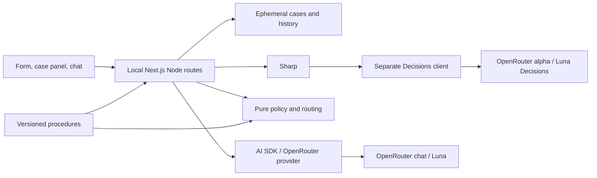
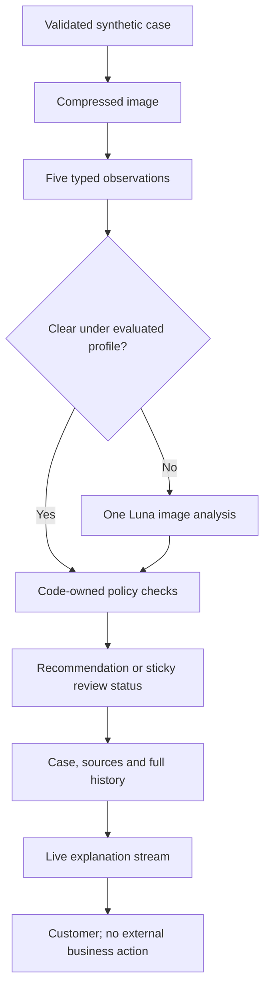

# ADR-000: Hardware Service Decision Copilot - Main Architecture

**Date:** 2026-11-05
**Status:** Proposed; initialization and implementation await plan approval.
**PRD:** [Product requirements](../PRD.md)
**Related:** [Decision assessment](001-decision-assessment.md), [Streaming chat and UI](002-streaming-chat-ui.md)

## 1. Overview

Use one local Next.js application for the form, bounded image assessment, optional image-analysis escalation, and customer chat. The user selected `openai/gpt-6-luna-decisions` for initial assessment and `openai/gpt-6-luna` for conversation and escalation, both through OpenRouter. No database, authentication, staff handoff, or claims integration participates in this PoC.

The user confirmed five observations, local Windows operation, npm, and real provider endpoints for application use, manual QA and E2E. Only unit and integration tests may mock external models. The PRD's 10%/90% values are **candidate thresholds pending representative-case evaluation**. AC-16 through AC-18 describe outcome-distribution boundaries under an evaluated profile, not measured accuracy or an enabled default. Record the evaluated profile before enabling a shortcut; no evidence means escalation.

## 2. Technology Documentation References

Context7 was accessed through its MCP server, `https://mcp.context7.com/mcp`: `resolve-library-id` preceded `query-docs`. The configured tool alias was unavailable; the same MCP tools worked over JSON-RPC. The CLI attempt failed because its default npm cache was not writable. No application packages were installed. Context7 was the first documentation source for Tailwind and the other researched UI libraries.

| Technology | Verified Context7 ID | Primary reference / purpose |
|---|---|---|
| AI SDK | `/vercel/ai`; baseline `/vercel/ai/ai_7.0.0` | [Docs](https://ai-sdk.dev/docs), [repository](https://github.com/vercel/ai), [v7 migration](https://ai-sdk.dev/docs/migration-guides/migration-guide-7-0); current base ID covers later additions |
| Next.js | `/vercel/next.js`; also queried `/vercel/next.js/v16.2.9` | [Initialization CLI](https://nextjs.org/docs/app/api-reference/cli/create-next-app), [environment loading](https://nextjs.org/docs/app/guides/environment-variables) |
| Tailwind CSS | `/tailwindlabs/tailwindcss.com` | [Framework setup](https://tailwindcss.com/docs/installation/framework-guides/nextjs); v4 CSS theme and PostCSS |
| shadcn/ui | `/shadcn-ui/ui` | [AI Elements migration](https://ui.shadcn.com/docs/ai-elements), [Chat pattern](https://ui.shadcn.com/docs/ai-elements/base/chat) |
| AI Elements | `/vercel/ai-elements` | [Project notice](https://elements.ai-sdk.dev/); successor components selected |
| assistant-ui | `/assistant-ui/assistant-ui` | [SDK v7 integration](https://www.assistant-ui.com/docs/runtimes/ai-sdk/v7); alternative evaluated |
| OpenRouter | `/websites/openrouter_ai`, `/openrouterteam/docs` | [Overview](https://openrouter.ai/docs), [AI SDK provider](https://openrouter.ai/docs/guides/community/vercel-ai-sdk) |
| Sharp | `/lovell/sharp/v0.35.5` | [Operations](https://sharp.pixelplumbing.com/api-operation/); server image preparation |
| Vitest | `/vitest-dev/vitest` | [Testing](https://vitest.dev/guide/); unit/integration runner |
| Playwright | Official documentation | [Test runner](https://playwright.dev/docs/intro); actual-stack E2E/manual evidence |

Registry metadata checked on 2026-11-05: Next.js/create-next-app 16.4.5, `ai` 7.0.163, `@ai-sdk/react` 4.0.167, `@openrouter/ai-sdk-provider` 3.1.0, Tailwind 4.3.4, Sharp 0.35.5, Zod 4.6.7, Vitest 5.1.0, and Playwright 1.64.1. These are research snapshots, not an installed/tested set. Sources include [AI SDK](https://registry.npmjs.org/ai/latest), [React SDK](https://registry.npmjs.org/@ai-sdk/react/latest), [provider](https://registry.npmjs.org/@openrouter/ai-sdk-provider/latest), and [Next.js](https://registry.npmjs.org/next/latest). Freeze compatible versions in the implementation lockfile; package version numbers need not match.

## 3. System Architecture

### Stack and runtime

One Node.js process, one origin, Next.js App Router route handlers, TypeScript strict mode. Bind the server to loopback. The machine has Node 24.22.1 and npm 11.19.1; the researched AI SDK/provider require Node >=22 and Vitest supports Node 24. Use Node runtime for Sharp and process-local state. Edge, serverless and multi-process deployment are outside this decision.

| Layer | Selection | Reason |
|---|---|---|
| Application | Next.js 16, React, strict TypeScript | Requested stack; same-origin UI/backend |
| Chat | AI SDK 7, React SDK 4, OpenRouter provider 3 | Supported UI message streaming |
| Initial assessment | Native server HTTP Decisions client with Zod validation | Explicit alpha protocol; ADR-001 explains adapter research |
| Escalation | AI SDK `generateText` structured output with Luna | One bounded image review |
| UI | Current shadcn/ui chat components, Tailwind 4 | Streaming-aware presentation and existing design tokens |
| Images | Sharp | Decode, orient, strip metadata, resize/compress |
| State | Process memory and tab-local React state | No persistence infrastructure |
| Verification | Vitest, React Testing Library, Playwright | Deterministic tests and real-stack checks |

### Repository and initialization

The actual `app/` contains only a course README, no package manifest. After plan approval, temporarily preserve `app/README.md` outside the target folder and confirm no other conflicting files appeared. From the repository root run the following initialization command, **recorded here but not executed**:

`npx create-next-app@16.4.5 app --ts --eslint --tailwind --app --src-dir --use-npm --import-alias "@/*" --disable-git --no-agents-md --yes`

Recheck that version's flags before running it. Restore the course README, merging actual generated start/build commands. Inspect generated scripts, strict mode, dependencies and options instead of trusting saved CLI preferences. Do not create a nested Git repository or overwrite outer agent guidance. Add only selected dependencies/components and required test infrastructure after scaffolding.

Future layout: `app/src/app/` for pages/routes; `app/src/components/` for form/chat/case panel and UI primitives; `app/src/server/` for providers, image preparation, case store, procedures and scenario instructions; `app/src/domain/` for shared validation and pure rules. Tests stay near affected modules, with actual-stack tests in `app/e2e/`. Existing repository assets/design guidance remain the visual source. No generic workflow engine or plugin architecture is required.

## 4. Module Structure & Dependencies

| Module | Responsibility and dependencies |
|---|---|
| Form/chat shell | Inputs, stage display, case projection; depends on shared contracts/UI/local routes |
| Assessment coordinator | Validation -> image preparation -> Decisions -> optional escalation -> policy rules; owns orchestration |
| Decisions client | Exact HTTP request/response only; native HTTP, validation and server key |
| Escalation client | One structured image analysis; AI SDK/OpenRouter Luna |
| Policy/routing domain | Dates, supported scope, probability interpretation, sticky review; no network |
| Chat route | Trusted context/history and streaming; case store, scenario sources, Luna |
| Case store | Ephemeral data, operation lock, deduplication and cleanup; Node memory |

Routes depend on coordinators/clients/domain; domain imports neither routes nor UI. Client components never import server configuration or provider modules. Apply a `server-only` boundary to those modules.

## 5. Data Models and Lifetime

| Entity | Fields and relationships | Lifetime |
|---|---|---|
| Intake | PRD enums, model text, purchase/receipt calendar dates, buyer/channel, description | Browser form, then immutable server case |
| Prepared image | JPEG bytes, dimensions, orientation/compression profile, hash | Until assessment/escalation completes; then discard server bytes |
| Observation | Five fixed IDs, typed probabilities, result/unknown, source stage, reason codes | Inside assessment |
| Assessment | Observations, escalation, deterministic findings, policy version, status/reasons, assessment date | Server case and read-only browser projection |
| Case | Random 256-bit capability, intake, assessment, full accepted history, lock, last activity | One process, no disk/database |
| Turn | Server ID, role, text parts, completion state, request ID | Canonical history plus UI projection |

Case capabilities remain in tab memory, never URLs, cookies, browser storage or logs. Refresh opens an empty UI; orphaned server cases expire after 30 minutes of inactivity. Restart clears all cases. Limit this local PoC to 20 active cases; return capacity error instead of silently evicting one. These are resource choices, not performance promises. Reset deletes the case, cancels work, and revokes the browser image preview URL.

## 6. API / Interface Contracts

| Local boundary | Input | Output/errors |
|---|---|---|
| `POST /api/assessment` | Multipart PRD intake, one image, client request ID | NDJSON stage events and one terminal case/assessment result; validation errors 400/413/415/422 before streaming |
| `POST /api/chat` | Case capability, operation `initial`/`message`/`retry`, request ID, current user text when applicable | AI SDK UI message SSE; 400 malformed, 404 unknown, 410 expired, 409 concurrency, 413 oversized, 502/504 pre-stream provider failure |
| `DELETE /api/case` | Case capability | Idempotent 204 after cancellation/deletion |

After assessment headers are sent, provider failures produce a terminal result event with review required and an unavailable stage, not fabricated success or another HTTP status. Disconnect cancels unfinished work; partial results cannot authorize chat. Assessment NDJSON is never the chat protocol.

A valid case whose conversational provider fails also gains a persistent server-owned review reason. Preserve assessment evidence; return the updated status projection with a pre-stream error or as stream metadata before a post-header error when possible. A successful retry never clears that requirement. Customer cancellation alone is not a provider outage.

Validate Origin when present, restrict requests to same origin, avoid permissive CORS and bind to localhost. A capability is a local PoC boundary, not production authentication. Accept only user text/delta on chat requests. Reject client system prompts, policies, assistant history, tools, provider URLs and replacements for observations/status. Reconstruct full context on the server. No customer-service notification or external business mutation endpoint exists.

## 7. Environment Variables

Start from [.env.example](../../.env.example), retaining blank values. The implementation copies its contract to the application-level example; the human supplies real configuration through the local Next.js environment loader. Do not inspect denied secret files.

| Variable | Required for live use | Public example / purpose |
|---|---|---|
| `OPENROUTER_API_KEY` | Yes | Blank in committed files; server-only key shared by both protocols |
| `LLM_MODEL` | Yes | `openai/gpt-6-luna`; chat and escalation |
| `DECISION_MODEL` | Yes | `openai/gpt-6-luna-decisions`; separate initial assessment |

Server constants identify chat `https://openrouter.ai/api/v1/chat/completions` and Decisions `https://openrouter.ai/api/alpha/decisions`. No second key, public key variable, mock mode, database URL or configurable proxy is required. Missing values produce explicit configuration errors, never silent model substitution. Do not use `NEXT_PUBLIC_` or expose key-bearing configuration through a client bundle. Log only stage, duration, model/request IDs and sanitized errors, not keys, request bodies or image data.

## 8. Technical Decisions

### Minimal starter rather than a complete chatbot product

**Status:** Proposed. **Date:** 2026-11-05.
**Context:** The application is empty and excludes accounts/history.
**Decision:** Use create-next-app plus selected UI components.
**Rejected alternatives:** [chat-sdk.dev](https://chat-sdk.dev/) currently describes a cross-platform bot SDK, not the web template described in the brief. The actual [Vercel chatbot](https://github.com/vercel/chatbot) is a complete application whose extra features/dependencies would require scope reduction. Neither supplies this bounded assessment pipeline.
**Consequences:** (+) Small scope and explicit boundaries. (-) The form/case panel require custom work.
**Review trigger:** Authentication, saved conversations or multi-platform bots become approved requirements.

### Separate conversation and Decisions protocols

**Status:** Proposed. **Date:** 2026-11-05.
**Context:** Typed assessment and live conversation require different payloads.
**Decision:** AI SDK/OpenRouter for chat; an isolated Decisions client for initial assessment.
**Rejected alternatives:** Routing a decision model through chat; using [Responses](https://openrouter.ai/docs/api_reference/responses/overview) as a universal API. Responses is a genuine ordinary-LLM alternative, but does not replace Decisions or supply the browser UI protocol. Its documented interface is stateless and rejects `store: true` and non-null `previous_response_id`.
**Consequences:** (+) Explicit, verifiable protocols. (-) Both need separate live checks.
**Review trigger:** A pinned current adapter proves the exact multimodal contract with less integration code.

### Ephemeral authoritative state

**Status:** Proposed. **Date:** 2026-11-05.
**Context:** The browser must not clear a required review flag by editing JSON.
**Decision:** Keep assessments/full accepted history in server memory, referenced by a tab-local capability.
**Rejected alternatives:** Unsigned client-owned assessments; database or signed-state machinery for a local-only slice.
**Consequences:** (+) No persistence infrastructure. (-) Restart loses state; multiple processes unsupported.
**Review trigger:** Deployment, multiple processes or session recovery is requested.

## 9. Diagrams

### Architecture



### Data flow



### Reset and stale state

```mermaid
sequenceDiagram
    participant B as Browser
    participant S as Next.js
    participant M as Memory
    B->>S: DELETE case after confirmation
    S->>M: Cancel work and delete context
    S-->>B: 204
    B->>B: Clear form, preview and chat
    Note over B,M: Refresh opens empty UI; restart clears memory
    B->>S: Stale case capability
    S-->>B: Context unavailable; start new case
```

## 10. Testing Strategy

Use specification-based Red -> Green -> Refactor. This documentation task does not initialize the application or execute future tests.

| Layer | Scope | Provider behavior |
|---|---|---|
| Unit | Validation, dates, probability routing, review precedence | Vitest; dependencies mocked as needed |
| Integration | Real local route/image/policy/store/stream pipeline | Only external model boundaries mocked |
| Provider smoke | Exact image Decisions contract, Luna escalation and live stream | Real OpenRouter endpoints |
| E2E | Form -> assessment -> first response -> follow-up -> reset | Playwright, real stack/providers, no interception |
| Manual QA | Actual browser flow, Polish text, streaming, errors and brand | Real providers and screenshots |

Capture a fresh authorized synthetic Decisions response before deriving its response mocks. Record sanitized status, headers, body, date, endpoint and model version in test-only evidence. No replay or fixture fallback enters application code. SDK conversational unit/integration tests use its documented synthetic model helpers. Pure local tests can precede provider capture.

Record typecheck, explicit lint, tests, build, startup, provider smoke and manual QA separately, with discovered/pass/skip counts. Use actual generated project scripts. Build is not proof of startup or lint. Exercise known service failures in unit/integration tests; real E2E outages remain failures, not mocked passes.

- TAC-000-01: No scaffolding, integration implementation or real-key file is created by this ADR task.
- TAC-000-02: Client bundles and browser requests contain no provider key.
- TAC-000-03: Client assessment/history/status edits cannot replace canonical server data.
- TAC-000-04: Refresh starts empty; process restart invalidates old cases.
- TAC-000-05: Live evidence identifies both actual provider protocols separately from synthetic test passes.

## 11. Remaining Gates

Approve the implementation plan before initialization. At implementation, freeze compatible packages, run real provider smoke checks, evaluate thresholds, and verify image preparation preserves fine defects. Alpha Decisions stability, component-registry changes and natural-language grounding are material risks. None implies that the user's OpenRouter access is unavailable.
