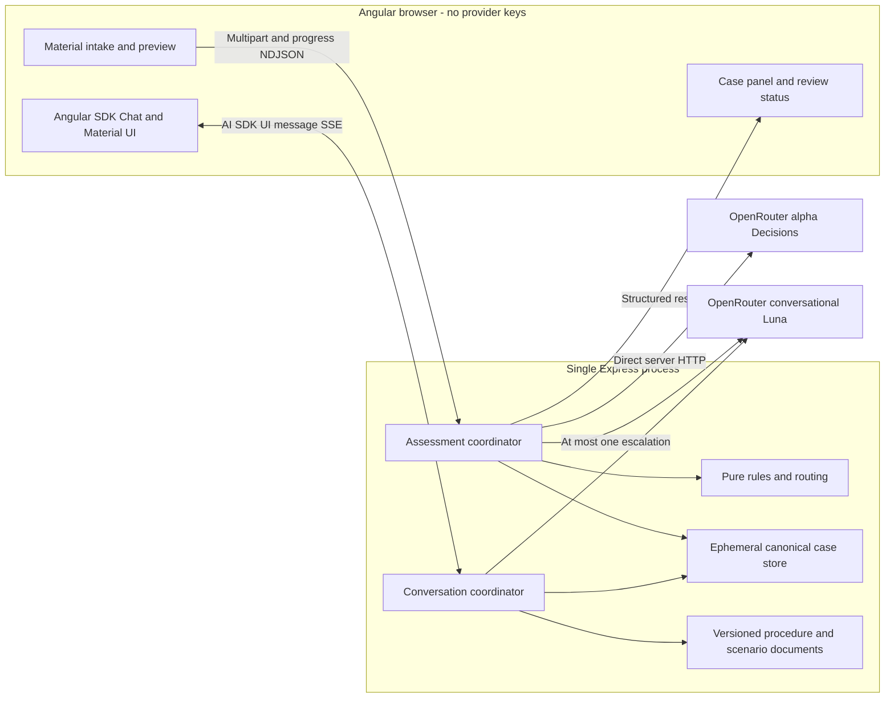
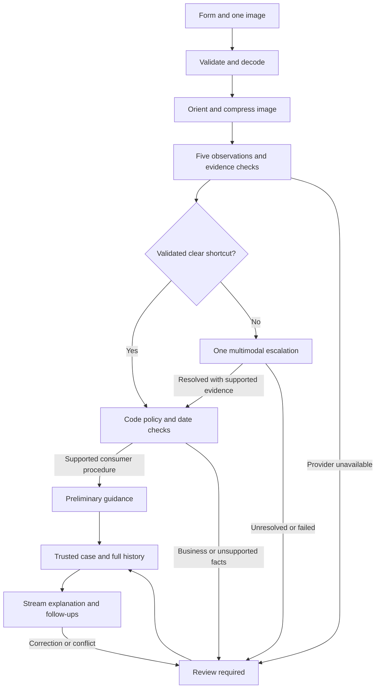

# ADR-000: Hardware Service Copilot - Angular Architecture

**Date:** 2026-11-06

**Status:** Proposed; implementation starts only after the implementation plan is approved

**PRD:** [Hardware Service Decision Copilot](../PRD.md)

**Related:** [Decision assessment](001-decision-assessment.md), [Angular UI and streaming](002-angular-streaming-ui.md)

## 1. Scope and agreed constraints

Build the PRD's local Windows PoC: one image and form, bounded assessment, optional multimodal escalation, procedural recommendation or persistent employee-review advice, then Polish text chat. Angular and Angular Material, all five observations, local deployment with one Node.js backend, and the testing policy below are user decisions. No database, authentication, staff integration, RAG, or public deployment is required.

The application remains an empty scaffold during this task. These ADRs define the recommended architecture; they neither implement provider integrations nor initialize a template. Research was delegated to Luna agents; the coordinating agent selected the approach. Documentation checks are not live integration evidence.

## 2. Technology Documentation References

Context7 IDs below were resolved before queries. Version-specific SDK queries used `/vercel/ai/ai_7.0.0`; official migration pages were consulted to resolve stale indexed examples.

| Technology | Verified Context7 ID / official primary source | Purpose |
|---|---|---|
| Vercel AI SDK | `/vercel/ai`, `/vercel/ai/ai_7.0.0`; [docs](https://ai-sdk.dev/docs), [repository](https://github.com/vercel/ai) | Streaming, Angular transport, multimodal generation, evaluation |
| Angular | `/websites/angular_dev`; [compatibility](https://angular.dev/reference/versions), [CLI](https://angular.dev/cli/new) | Standalone browser application and bootstrap |
| Angular Material | `/angular/components`; [theming](https://material.angular.dev/guide/theming) | Native Angular components and brand theme |
| OpenRouter AI SDK provider | `/openrouterteam/ai-sdk-provider`; [repository](https://github.com/OpenRouterTeam/ai-sdk-provider), [integration guide](https://openrouter.ai/docs/guides/community/vercel-ai-sdk) | Selected chat adapter; evaluated Decisions adapter |
| OpenRouter TypeScript SDK | `/openrouterteam/typescript-sdk`; [repository](https://github.com/OpenRouterTeam/typescript-sdk) | Evaluated alternative Decisions client |
| OpenRouter APIs | [docs](https://openrouter.ai/docs), [Responses overview](https://openrouter.ai/docs/api_reference/responses/overview) | Provider contracts and alternative API |
| Express | [AI SDK Express example](https://ai-sdk.dev/cookbook/api-servers/express), [Express 5 reference](https://expressjs.com/en/api/) | One TypeScript backend with Node response streaming |
| UI alternatives | `/hassantayyab/angular-ai-kit`; source comparisons in [ADR-002](002-angular-streaming-ui.md#3-starter-and-component-comparison) | Evidence for starter selection |

Sources were checked on 2026-11-06. They establish documented interfaces, not observed responses from this application. Before scaffolding, verify the exact published dependency metadata and freeze a compatible lockfile.

## 3. Architecture and repository shape

Use an Angular SPA and one Express backend. During development Angular's `/api` proxy targets the backend; the browser never calls OpenRouter directly. The compiled SPA can be served by the same backend for local built-application QA. No SSR or separate model worker is needed.

| Layer | Selected technology | Reason |
|---|---|---|
| Runtime | Node.js 24, at least 24.15; ESM and TypeScript | Meets Angular 22's documented runtime range and provider's Node 22 minimum |
| Frontend | Angular 22, Angular Material/CDK 22, SCSS | User constraint; standalone components and signals |
| Chat state/transport | `@ai-sdk/angular` 3 with `ai` 7 | First-party Angular binding to the SDK UI message stream |
| Backend | Express 5 and AI SDK 7 | Official Angular/Express streaming example; one process |
| Chat provider | `@openrouter/ai-sdk-provider` 3.1.0 | Documented SDK 7 language-model adapter; verify the installed chat path |
| Decisions transport | Node's server-side `fetch` plus Zod validation | Uses the documented raw endpoint without an unreleased SDK adapter fix |
| Conversation/escalation | `openai/gpt-6-luna` | Documented text/image model; one selected LLM for both responsibilities |
| Initial assessment | `openai/gpt-6-luna-decisions` | Separate typed multimodal assessment; see ADR-001 |
| Validation | Zod 4 compatible with the provider's published peer range | Validate form, normalized observations and escalation output at boundaries |
| State | Backend process memory and browser memory | Matches no recovery/history requirement |

Research found published `ai` 7.0.163, `@ai-sdk/angular` 3.0.163 and OpenRouter provider 3.1.0. The provider manifest declares `ai:^7.0.0`, but its released Decisions adapter is incompatible with newer state/image contracts; see ADR-001. The current SDK feature is `experimental_decide`, renamed from `experimental_evaluate` in 7.0.128. Exact published Angular adapter peer metadata could not be retrieved, so the apparent release pairing is a candidate tuple, not a verified installation. Angular's current table supports Angular 22 with TypeScript 6.0.x. The Vercel example's Angular 21/TypeScript 6 combination conflicts with that table and must not be copied blindly. [Provider release source](https://github.com/OpenRouterTeam/ai-sdk-provider/tree/3.1.0), [SDK rename](https://github.com/vercel/ai/releases/tag/ai%407.0.128), [Angular adapter package](https://www.npmjs.com/package/%40ai-sdk/angular), [Angular compatibility](https://angular.dev/reference/versions).

Use npm workspaces under `app/`, with one lockfile:

- `app/frontend/`: Angular intake, assessment progress, case panel and chat.
- `app/backend/`: Express routes, domain rules, image preparation, model clients, in-memory cases, scenario instructions and attributed procedure documents.
- `app/e2e/`: real-stack Playwright tests.
- `app/tests/fixtures/`: sanitized real provider captures and separate provenance; deliberate mutations are labeled as such.
- `docs/qa/`: manual QA screenshots, live smoke evidence and evaluation findings without credentials.

Keep the existing repository-level design assets and [design guidance](../design-guidelines.md). Do not add a monorepo framework, database, Redis, resumable-stream infrastructure or React runtime.

## 4. Modules and dependency direction

The Angular application depends on application HTTP contracts, Material primitives and the Angular SDK adapter. It has no provider dependency or secret configuration.

Express routes depend on the assessment coordinator, chat coordinator and case store. The assessment coordinator calls image preparation, the Decisions client, pure policy/routing functions and, if required, the escalation client. The chat coordinator reads immutable assessment data, current review state, versioned scenario/procedure content and canonical history before calling the conversational model.

Provider adapters return validated application records. Pure domain functions depend on neither Express nor SDK message types. The case store is authoritative for assessment, history, operation ownership and review state. No circular dependency or provider call from a domain rule is allowed.

## 5. Data models and lifetime

| Record | Required contents | Lifetime |
|---|---|---|
| Submitted case | Opaque case token, immutable form, assessment date in Europe/Warsaw, image preparation metadata | Backend memory for active case |
| Prepared image | Decoded/normalized bytes, actual MIME, dimensions, processing limitations | Until assessment/escalation finishes; then discard server bytes |
| Observation | One of five IDs, supported probability or null, evidence status/basis, limitations, conflicts, model/question/profile versions | Immutable initial result |
| Assessment | Five observations or explicit unavailable stage, optional single escalation result, code-derived procedure findings and source versions | Immutable result, separate from later chat clarifications |
| Review state | Required boolean plus additive reasons | Monotone: false may become true; true never becomes false |
| Chat turn | Server-recognized IDs, user content, assistant parts, complete/partial/failed status, attempt identity | Backend canonical history; mirrored for UI rendering |
| Operation | Case, operation ID, stage, pending/completed/failed state, active cancellation handle | Prevents overlapping submissions and chat sends |

Keep form fields and image preview in browser memory. No localStorage, IndexedDB, recovery cookie or database history. A refresh starts empty and loses the browser's case token; confirmed reset deletes the server case and clears browser state. Browser-close deletion is best effort, so unreachable text records may remain in backend memory until cleanup or process restart; do not claim guaranteed immediate server deletion on tab close. No old case is automatically reattached.

Use high-entropy per-case tokens held only in tab memory and same-origin requests. This provides local case isolation, not a production authentication system. Do not accept a browser-supplied assessment, review flag, provider model, instructions or assistant transcript as authoritative.

## 6. Application API contracts

These are local application endpoints. OpenRouter's chat and Decisions endpoints remain separate outgoing integrations.

| Endpoint | Input | Output and failure contract |
|---|---|---|
| `POST /api/assessment` | Multipart PRD form, exactly one image, client operation ID | Validate fields and decode image before any model call. Invalid input: HTTP 422 with field errors, no cleared browser fields. Valid input: application NDJSON stream of stage events and exactly one terminal result containing case token and structured assessment. Provider failures are terminal review-required results, not fabricated observations. |
| `POST /api/chat` | JSON containing case token, operation/turn/attempt IDs and intake, follow-up, summary or retry intent | Standard AI SDK UI message SSE response. Backend loads canonical form/result/history; validates the newly submitted user message. Initial generation needs no invented greeting. Follow-ups cannot invoke Decisions or image escalation. |
| `GET /api/case` | Case token in a header | Current structured assessment, review reasons and operation state; no raw image, keys or prompts. Used to reconcile review state after a chat tool changes it or a stream fails. |
| `DELETE /api/case` | Case token after reset confirmation | Cancel active work, delete case, return 204. Browser clears form, preview, tokens and history. |

NDJSON assessment records have a type (`stage`, `result`, `error`), case/operation identity where available, and a typed payload. Stages are validation, image preparation, initial assessment, optional escalation, and ready for chat. The terminal result is required even when a provider fails. An interrupted connection with no terminal record is an incomplete operation, never success. Browser `fetch` consumes this multipart response; it is not the AI SDK chat transport or the OpenRouter Decisions protocol.

Unknown/removed case: 410; overlapping operation: 409; unsupported input/media: 422; oversized upload: 413. Validate before streaming headers when possible. After streaming begins, use the documented stream's error event and retain already completed state. Never put provider exception bodies, credentials or instructions into customer errors. The UI renders concise Polish errors and the affected stage.

The server enforces one active operation per case, not just disabled buttons. Repeated operation IDs return/reconcile existing state rather than repeating assessment. Cancelled or interrupted assessment is not retried automatically; the customer explicitly starts a new case. Chat retry retries only the failed generation attempt against its saved input.

## 7. Configuration and initialization

The existing root [.env.example](../../.env.example) is the configuration contract. Keep actual values local and server-only; use Node's environment-file loader or process environment for the backend. Angular receives no provider key or provider configuration file. Do not require Vercel AI Gateway credentials.

| Variable | Required for | Example non-secret value |
|---|---|---|
| `OPENROUTER_API_KEY` | Live capture, smoke, E2E/manual QA and provider calls | Empty placeholder only |
| `LLM_MODEL` | Conversation and the one optional multimodal escalation | `openai/gpt-6-luna` |
| `DECISION_MODEL` | Initial Decisions request | `openai/gpt-6-luna-decisions` |

Use the provider's documented default chat base URL `https://openrouter.ai/api/v1` and the dedicated HTTP client's Decisions endpoint `https://openrouter.ai/api/alpha/decisions`. No additional environment variable is necessary for this PoC.

Initialization is deferred until plan approval. From repository root, the proposed Angular initialization command is `npx @angular/cli@22.2.6 new frontend --directory app/frontend --standalone --routing --style=scss --package-manager=npm --ssr=false --skip-git --skip-install --defaults`. After workspace metadata/dependencies are prepared and verified, from `app/frontend` use `npm exec -- ng add @angular/material@22.2.5` and select the custom brand theme. Keep `app/` scaffold-only; create no package manifest or app code during this ADR task. [CLI options](https://angular.dev/cli/new), [Material installation](https://github.com/angular/components/blob/main/guides/getting-started.md).

The bootstrap source is the [official Angular quickstart](https://ai-sdk.dev/docs/getting-started/angular) and [Angular/Express example](https://github.com/vercel/ai/tree/main/examples/angular). Reconcile its workspace-only package references with the verified published tuple rather than cloning a monorepo subdirectory and assuming it installs independently. Detailed starter comparison is in ADR-002.

## 8. Decisions and alternatives

### Separate SDK chat from direct Decisions HTTP

**Status:** Proposed. **Date:** 2026-11-06. **Context:** The product requires streamed conversation and a different typed initial assessment. **Decision:** Use the provider's language model for `streamText`/multimodal generation and native server HTTP for Decisions, with separate clients, schemas and tests. **Rejected alternatives:** The released Decisions adapter lacks the newer SDK state/image fix; installing unreleased `main` is unnecessary risk for this PoC. The native OpenRouter TypeScript SDK adds another dependency for a single bounded endpoint. Responses introduces another conversation API without replacing Decisions. **Consequences:** One shared server key; a small explicit alpha-protocol parser to maintain, with pinning/captures/migration checks. **Review trigger:** A published, verified compatible Decisions adapter or a breaking API change. [Released adapter](https://github.com/OpenRouterTeam/ai-sdk-provider/blob/3.1.0/src/evaluation/index.ts), [fix PR](https://github.com/OpenRouterTeam/ai-sdk-provider/pull/577).

### Evaluate the supplied alternatives against the actual product

| Option | Research finding | Fit / selected use |
|---|---|---|
| Vercel AI SDK Core + Angular UI adapter | Framework-independent server APIs and first-party signal-based Angular chat | Selected; provides the required stream and model boundaries |
| `chat-sdk.dev` | Current site describes multi-platform bots with channel adapters/state, rather than the web app named in the prompt | No platform bot or external messaging in this PRD |
| Vercel Chatbot web template | React/Next.js, shadcn/Tailwind, Auth.js, Postgres and Blob; default AI Gateway | Useful reference, excessive migration/removal for this Angular, ephemeral PoC |
| OpenRouter Responses | Separate `/api/v1/responses`; stateless, rejects `store:true` and non-null `previous_response_id` | No benefit requiring a second conversation API; does not replace `/api/alpha/decisions` |
| OpenRouter AI SDK provider | SDK 7 chat; released Decisions adapter lags current SDK image/state contract | Selected for conversation/escalation; direct HTTP for Decisions |

The original Chat SDK web template has been renamed [Chatbot](https://github.com/vercel/chatbot); the [new Chat SDK](https://chat-sdk.dev/) has a different purpose, as explained in [Vercel's announcement](https://vercel.com/blog/introducing-chatbot). The Responses [overview](https://openrouter.ai/docs/api_reference/responses/overview) and [reference](https://openrouter.ai/docs/api/api-reference/responses/create-responses) have an ambiguous stability signal: the generated operation name contains beta while the overview does not promise stability. No Responses method was verified in the selected provider's public documentation. Revisit if Responses-only capabilities become a product requirement.

## 9. Diagrams

### Components and trust boundaries



### Evidence and status flow



### Initial assessment and failure

```mermaid
sequenceDiagram
    actor Customer
    participant UI as Angular
    participant BE as Express
    participant D as Decisions
    participant L as Luna
    Customer->>UI: Submit synthetic form and image
    UI->>BE: Multipart assessment
    BE-->>UI: Stage events
    BE->>BE: Validate, prepare image, retain immutable input
    BE->>D: Separate typed Decisions request
    alt Valid result
        D-->>BE: Typed probabilities and evidence categories
        opt Uncertain or shortcut not validated
            BE->>L: One bounded multimodal analysis
            L-->>BE: Supported observations or unresolved issues
        end
        BE->>BE: Code rules and final status
    else Provider failure
        D-->>BE: Error or invalid response
        BE->>BE: Review required; no invented observations
    end
    BE-->>UI: Terminal structured result and case token
    UI->>BE: Start first assistant generation
    alt Chat available
        BE->>L: Trusted case context and scenario instructions
        L-->>BE: Text stream
        BE-->>UI: UI message SSE
    else Chat unavailable
        BE-->>UI: Explicit error; retain structured fallback
    end
```

## 10. Testing and acceptance

Write tests before production changes and show Red -> Green -> Refactor. Pure domain tests may construct synthetic form/evidence inputs from the PRD. Before creating or refreshing any provider/endpoint mock, make a fresh accepted call to the real endpoint with safe synthetic data. Save the accepted request, complete status/headers/body or raw stream, model/service version, date and target, with credentials removed. Then derive mocks from those captures. A missing safe capture blocks mock creation; documentation or an older fixture alone is insufficient. AI SDK test models/helpers may replay captured behavior after this prerequisite.

| Layer | Required verification |
|---|---|
| Unit | Pure rules, schemas and state machine; capture-derived model doubles only after real requests |
| Integration | Real app modules/routes/store/image handling; only external model APIs may use fresh capture-derived mocks |
| Live smoke | Separate real Decisions request, real multimodal escalation and real streamed chat/follow-up |
| E2E | Playwright against the real app and real OpenRouter endpoints; no mocks, response interception or provider stubs |
| Manual QA | Actual Chrome/Edge flow, real endpoints/models, screenshots and console/network review |

Do not impose spend, test-call-count or evaluation-sample caps. The PRD's one initial assessment and at most one escalation per case remain functional requirements. Cancellation, duplicate prevention and actual provider timeouts still need correct handling. Unavailable credentials/services block live verification; they never justify replacing it with a fixture and calling it a pass. Deterministic outage simulations belong to capture-derived unit/integration tests; live tests report actual observed failures.

- TAC-000-01: All PRD ACs map to tests; runtime changes record build, discovered/executed/skipped tests, startup and manual QA separately.
- TAC-000-02: Captures establish the chat and Decisions wire contracts separately before mocks exist. A fixture alone never establishes a complete provider integration.
- TAC-000-03: Initial assessment failure retains form facts, marks the unavailable stage and produces review required. Conversation failure retains the structured result and any existing review requirement.
- TAC-000-04: Concurrent requests and retries cannot repeat the original assessment or lift a review requirement. Later text corrections can only add review reasons.
- TAC-000-05: E2E/manual QA covers return, complaint with invisible fault, all review paths, summary, partial stream/error, chat-only retry and confirmed reset using the real stack.
- TAC-000-06: No server key, raw provider exception or hidden instruction appears in Angular assets, HTTP customer errors, screenshots or committed captures.
- TAC-000-07: This ADR task passes content, consistency and link checks only. No application build, startup, provider smoke or runtime QA is claimed before implementation.
