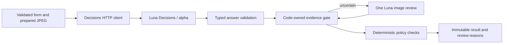

# ADR-001: Bounded Multimodal Decision Assessment

**Date:** 2026-11-05
**Status:** Proposed
**Relates to:** [Main architecture](000-main-architecture.md), [PRD](../PRD.md)

## 1. Scope

Initial image/form assessment: five observations, code-owned routing, deterministic policy checks and at most one multimodal escalation. Ordinary conversation belongs to [ADR-002](002-streaming-chat-ui.md). This ADR neither implements nor calls the provider.

## 2. Technology Documentation References

| Source | Verified Context7 ID or primary reference | Finding |
|---|---|---|
| OpenRouter Jev | `/websites/openrouter_ai`; [guide](https://openrouter.ai/docs/guides/community/jev) | Separate Decisions and System One surfaces |
| Multimodal Decisions | Same ID; [guide](https://openrouter.ai/docs/guides/community/multimodal-decisions) | Provider-specific image formats and positions |
| Decisions API | Same ID; [reference](https://openrouter.ai/docs/api/api-reference/alphadecisions/submit-a-decisions-request) | Typed envelope, answers, refusal and errors |
| TypeSafe Noul | [Noul](https://docs.typesafe.ai/primitives/noul) | Probability of yes, no separate confidence |
| Confidence | [TypeSafe confidence](https://docs.typesafe.ai/confidence) | Distribution concentration is not correctness assurance |
| Luna Decisions | [Model page](https://openrouter.ai/openai/gpt-6-luna-decisions) | Image input and Noul/Choice/Score, not chat generation |
| AI SDK Decisions | `/vercel/ai`; [Decisions](https://ai-sdk.dev/docs/ai-sdk-core/decisions), [reference](https://ai-sdk.dev/docs/reference/ai-sdk-core/decide) | Current `experimental_decide`; deprecated `experimental_evaluate` |
| OpenRouter provider | [Repository](https://github.com/OpenRouterTeam/ai-sdk-provider), [3.1.0 package](https://registry.npmjs.org/@openrouter/ai-sdk-provider/3.1.0) | Existing adapter requires capability/version verification |
| Native SDK | [Alpha.Decisions](https://openrouter.ai/docs/client-sdks/typescript/sdks/decisions/README.md) | Documented `alpha.decisions.create` operation |
| Sharp | `/lovell/sharp/v0.35.5`; [operations](https://sharp.pixelplumbing.com/api-operation/) | Server image normalization |

The Jev guide, multimodal guide and Decisions reference were read before selecting the integration. Noul, confidence, Luna Decisions and published adapter code were then checked for semantics and suitability.

## 3. Component Design

### Model selection

| Candidate | Current ID, capability and API | Fit |
|---|---|---|
| Luna Decisions | `openai/gpt-6-luna-decisions`; text/images; `noul`, `choice`, `score`; `POST /api/alpha/decisions` | User-selected first model; matches bounded typed observations |
| Jev | `typesafe/jev-1.14`; guide also lists `~typesafe/jev-latest` and older 1.13; image input; Box added in 1.14 | Viable alternative; localization/Box unnecessary here |
| TypeSafe SDK/System One | `POST /api/v1/systemone` for TypeSafe-compatible requests | Jev-specific alternative; do not assume Luna uses it |
| Ordinary Luna | `openai/gpt-6-luna` | Generative chat/image analysis, not a substitute for the decision model |

The multimodal guide specifies Luna images as inline data URLs in top-level `state` items; text items are plain strings. Nested image objects and Responses `input_image` parts are different contracts. Jev accepts JPEG/PNG with additional dimension/size limits; the guide also permits WebP for Luna. Normalize PoC inputs to JPEG. Do not transfer Jev-specific limits or Box behavior to Luna.

### Transport decision

**Status:** Proposed. **Date:** 2026-11-05.
**Context:** An adapter exists, but its presence alone does not prove current multimodal compatibility.
**Decision:** Use one server-only native HTTP Decisions client, with runtime Zod validation. Keep wire names inside that module.
**Evidence:** Provider 3.1.0 documents `decisionModel()`/`evaluationModel()` and boolean-to-Noul mapping. The published implementation uses `doEvaluate` and forwards `state` unchanged. Current AI SDK documents `experimental_decide` and typed text/JSON/file state parts. Conversion of those image parts to Luna's required top-level `image_url` format was not established in the inspected package. This is a suitability limitation, not an observed live failure or a claim that all versions lack an adapter.
**Rejected alternatives:** An unverified adapter plus a format shim; the documented native OpenRouter SDK, which adds a dependency for one request; sending Decisions through `streamText`, chat completions or Responses.
**Consequences:** (+) One small explicit protocol boundary without a second experimental SDK layer. (-) Application owns parsing, validation and error normalization.
**Review trigger:** A pinned provider release documents and passes this exact image contract in a live smoke check.

### Image preparation

Accept one JPEG/PNG/WebP up to the PRD's 10,000,000 bytes. Verify decoded type, reject corruption and animated/multi-page images, and enforce a 40-million decoded-pixel ceiling for local memory safety. Report that ceiling as an application limit, not an OpenRouter restriction.

Apply EXIF orientation, flatten transparency against white, omit metadata, and encode JPEG server-side. Candidate compression profile: longer side at most 2048 pixels, preserved aspect ratio, no enlargement, quality 90, output at most 2,000,000 bytes. If oversized, retry compression locally at quality 85; if still oversized, show image-preparation error. Evaluate small cracks, scratches and reflections before accepting this profile. Compression cannot certify preservation of every defect.

Initial assessment and escalation receive the same prepared bytes/hash/profile. Do not host the upload publicly or fetch customer-provided remote URLs. Release server image bytes after these stages; chat receives observations/analysis, not repeated image uploads.

## 4. Data Structures and Semantics

### Five observations with explicit missing evidence

Keep five product observations. Use **Choice with three outcomes**, allowing insufficient evidence without abusing a zero probability.

| Observation ID | Positive option | Negative option | Unknown option |
|---|---|---|---|
| `image_usable` | `usable` | `unusable` | `not_assessable` |
| `item_relevant` | `consistent` | `inconsistent` | `not_assessable` |
| `visible_cracks` | `present` | `absent_in_visible_area` | `not_assessable` |
| `visible_dents` | `present` | `absent_in_visible_area` | `not_assessable` |
| `visible_scratches` | `present` | `absent_in_visible_area` | `not_assessable` |

Give every option an explicit criterion. Unreadable regions, unresolved contradictory visual claims and insufficient category/model evidence belong to unknown. Negative damage findings apply only to adequately visible regions. An invisible functional complaint does not contradict a photo without visible damage. Category consistency proves neither exact model nor authenticity.

Retain selected option, full option probability map when supplied, optional provider confidence, source stage and code-derived limitation labels. Each Choice distribution sums approximately to one; probabilities across the five questions do not. Display the positive option probability with its meaning, alongside unknown/negative information; do not display unknown as a definitive negative.

The initial API does not promise explanatory prose, damage location or bounding boxes. Label the evidence basis honestly as a classifier judgment about the supplied photo. Do not invent detailed visible evidence from a number. The optional escalation can supply a more detailed model-derived description.

### Question-type differences

- **Noul:** Its value is probability of yes. Near zero can be a confident no, near one a confident yes; the middle is uncertainty about the proposition, not moderate damage. It has no separate confidence field. Missing evidence would need an additional sufficiency gate.
- **Choice:** Read outcome and option probabilities. A concentrated unknown outcome still requires escalation. Confidence can be preserved for diagnostics but is not an independent source of evidence or the sole routing threshold.
- **Score:** Expected rubric position can be moderate even when probability is split between extremes. A future severity rubric would need full-distribution checks, not a threshold on the mean. No severity rubric is needed now.

These definitions explain semantics, not Luna's empirical calibration on hardware photos. No probability/confidence is a correctness guarantee.

## 5. Interface Contracts

### Exact Decisions boundary

Call `POST https://openrouter.ai/api/alpha/decisions` with server bearer authentication. Required body: `model`, `state`, `questions`. State is a top-level array containing plain textual context and one `image_url` part with an inline `data:image/jpeg;base64,...` URL. Questions are the five Choice definitions. Supply synthetic relevant form context; never ask the decision model to calculate deadlines or determine refund eligibility.

Do not send `messages`, `input_image`, a chat streaming flag, top-level `images`, or image parts nested in a state object. This call returns a complete typed response, independently of the later chat stream.

The `answers` map contains typed entries. A Choice has `type`, `choice`, and optional `probabilities`/`confidence`; a `refusal` has no answer value. Preserve optional request/resolved model/provider IDs and usage. Validate all five expected IDs, known types/options, finite probabilities in [0,1], expected distribution keys and sum tolerance 0.02 for rounding. Missing distributions, refusals and invalid entries become unknown and trigger deeper analysis, never numeric defaults or false certainty.

One attempt, 30-second deadline, cancellation propagated from the local request. No automatic paid retry or model substitution. Transport/auth/quota/provider failures produce sticky review required with an unavailable stage; do not silently replace the failed decision provider with a successful-looking LLM assessment.

### Code-owned routing

1. Validate fields and prepare the image; local errors stay on the form.
2. Call Decisions once and retain original probabilities with their meanings.
3. Apply hard overrides: unknown/refusal/missing data, unusable/inconsistent input and unresolved conflicts cannot use the shortcut.
4. Under an **evaluated** profile, accept a positive/negative observation only if that option clears its acceptance bound and competing/unknown outcomes satisfy the profile. Low positive probability alone does not prove a negative when unknown is possible.
5. Uncertain evidence triggers one Luna analysis. Before a routing profile is validated, use this same escalation path and label the profile unvalidated; do not claim the shortcut is ready.
6. Apply exact date and policy checks in code, following the PRD's source version and Europe/Warsaw calendar rules. Business/unsupported cases retain review advice.
7. Unresolved evidence/provider failure yields review required. Otherwise provide preliminary procedure guidance, never a legal entitlement or external action.

### Escalation boundary

Use AI SDK `generateText` with `Output.object` and a server schema through Luna. Send the same prepared image, form, initial observations and unresolved IDs. Output per unresolved ID: positive/negative/unresolved conclusion, visible supporting description, scope/limitations, and conflict/missing-evidence flags. Do not invent classifier probabilities or request legal eligibility.

One call, 45-second deadline, no automatic retry. Code requires each unresolved ID to be covered, supported by visible evidence and free of remaining relevant conflict/limitation. Schema validity alone does not prove evidence quality. Doubt, refusal, error or inadequate content remains unresolved. Once required, review is sticky for the case.

### Stability and unresolved limits

Decisions is explicitly **alpha** and its schema may change. AI SDK Decisions is independently experimental and may change in patch releases. Isolate the contract, retain sanitized live evidence, and recheck after changes to model/provider, questions, compression or client packages. No automatic Jev/Luna fallback: different numeric distributions require renewed evaluation.

The official sources support the selected question types and image positioning. Actual account rate limits, practical Luna payload ceiling, observed latency and calibration have not been measured here. The one-image limit and compressed-byte cap are product bounds, not provider guarantees. Confirm acceptance in a later real smoke check; this task performs no paid inference.

## 6. Threshold Decision and Evaluation

**Status:** Proposed. **Date:** 2026-11-05.
**Context:** Candidate 0.10/0.90 thresholds need evidence for this model and questions.
**Decision:** Evaluate after the live contract works; freeze per-observation profiles in code.
**Rejected alternatives:** Copying another provider's thresholds, treating confidence as correctness, or fitting thresholds against final evaluation cases.
**Consequences:** (+) Explicit evidence for routing. (-) Shortcut remains disabled until justified.
**Review trigger:** Model/provider, criteria, image preparation or observed routing failures change.

Use 32 labeled synthetic cases, eight per equipment category. Split in advance into 20 development and 12 held-out cases. Cover clean visible areas, obvious/fine damage, glare, blur, cropping, wrong category, ambiguous model identity, invisible functional faults, contradictory visual claims and image-embedded instructions. Labels identify visible facts and unknowns, never legal outcomes. Repeat six borderline cases three times to expose instability; repetition is not proof of truth.

Compare a predeclared small candidate set: low/high pairs 0.05/0.95, 0.10/0.90 and 0.20/0.80. A clear positive or negative requires its option probability at least high and each competing option, including unknown, at most low. Unknown winners always escalate. If several profiles qualify equally, retain 0.10/0.90 when available; otherwise choose the narrower acceptance region. On development cases choose the widest qualifying acceptance region with no unsupported clear result, no false clear-negative damage case, and no bypass of known missing evidence. Freeze before held-out evaluation. Any such held-out failure keeps the affected observation's shortcut disabled. Report clear-call correctness, false positives/negatives, unknowns, escalation rate, repeated-case disagreement, latency and supplied cost. This supports a demonstration, not a production calibration claim.

## 7. Diagrams

### Components and data flow



### Initial assessment and alternatives

```mermaid
sequenceDiagram
    participant B as Browser
    participant A as Assessment route
    participant D as Luna Decisions
    participant L as Luna
    B->>A: Synthetic intake and one image
    A->>A: Validate and compress
    A-->>B: Processing stages
    A->>D: state image and five typed questions
    alt Clear under evaluated profile
        D-->>A: Valid observations
    else Uncertain or incomplete evidence
        D-->>A: Unknown / incomplete observations
        A->>L: Image and unresolved questions
        L-->>A: Structured evidence or unresolved result
    else Decision provider error
        D-->>A: Error / timeout
        A->>A: Mandatory review; no substitute assessment
    end
    A->>A: Policy rules and review precedence
    A-->>B: Terminal result and case capability
```

## 8. Testing Strategy

Use Red -> Green -> Refactor. Application, manual tests and E2E always use real models. Capture a fresh authorized synthetic provider response before deriving non-chat endpoint response mocks; retain sanitized status/headers/body, date, model/provider and question/compression versions in test-only evidence. No fixture mode enters the app. Distinguish observed provider behavior from simulated unit/integration faults.

| Scenario | Layer | Expected result |
|---|---|---|
| Positive .01, negative .98, unknown .01 | Unit | Qualifying clear negative, not uncertainty merely because positive is low |
| Positive .01, unknown .98 | Unit | Unknown and escalation regardless of confidence |
| Split distribution or negative usability/relevance | Unit | Escalation |
| Missing/refused answer, invalid/out-of-range value, absent distribution | Unit/integration | Unknown, one escalation, no invented zero |
| Future/inconsistent dates, purchase vs receipt, year/month boundary | Unit/integration | Deterministic validation or review |
| Orientation/type/animation/pixel cap and fine detail | Integration/live evaluation | Correct preparation/error; no original uncompressed model input |
| Timeout, auth/quota/rate/provider errors | Integration; external model boundary only mocked | Visible review with reason; local data retained |
| Escalation lacks support, fails or remains conflicting | Integration | Persistent review |
| Business purchase, clear image | Integration/real E2E | Business questions and review advice, no handoff |
| Real Decisions image/Choice smoke | Live provider | Actual request accepted and five typed responses validated |
| Real Luna escalation smoke | Live provider | Prepared image accepted and structured evidence produced |

- TAC-001-01: Network evidence distinguishes `/api/alpha/decisions` from chat requests.
- TAC-001-02: Decisions image parts use the documented top-level format.
- TAC-001-03: Missing evidence cannot become a clear negative by defaulting a number.
- TAC-001-04: Successful assessment reports all five categories and source stages.
- TAC-001-05: A case makes at most one decision call and one optional image escalation.
- TAC-001-06: Real contract smoke and representative-case evaluation are separate from mocked test passes.
- TAC-001-07: An unvalidated profile is never presented as a validated shortcut or correctness guarantee.
