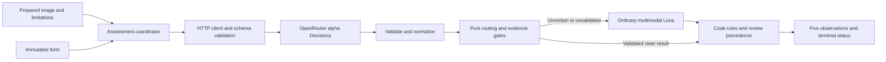
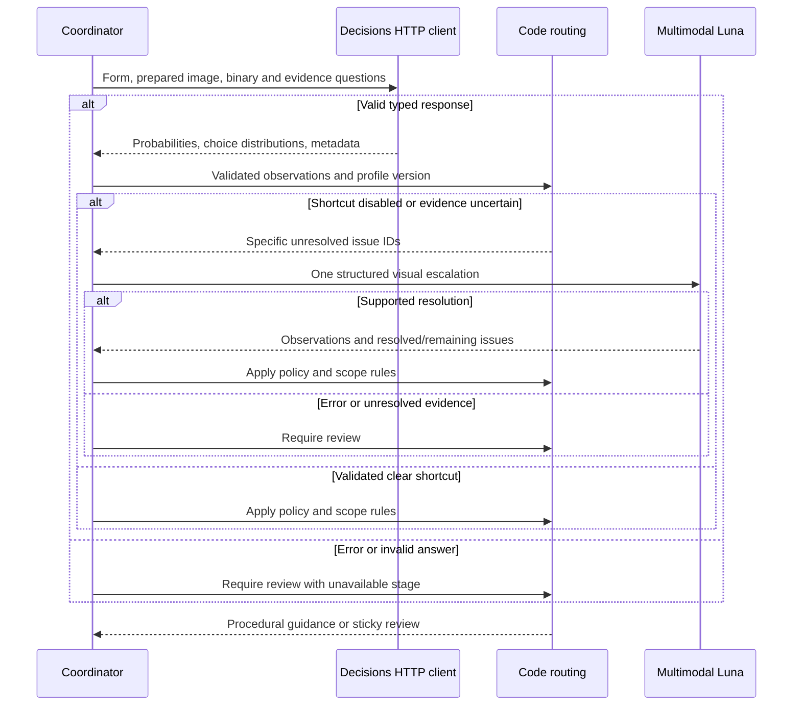

# ADR-001: Bounded Multimodal Decision Assessment

**Date:** 2026-11-06

**Status:** Accepted

**Relates to:** [Main architecture](000-main-architecture.md), [PRD Sections 4 and 11](../PRD.md#11-agent--system-behavior-specification)

## 1. Scope

One initial Decisions request evaluates the five agreed observations. Code owns exact policy/date checks and routing. At most one ordinary multimodal LLM call may resolve uncertainty before chat. No model approves a return, determines damage cause, rejects a complaint, assigns staff, or decides legal entitlement.

## 2. Technology Documentation References

| Source | Verified Context7 ID / official link | Evidence used |
|---|---|---|
| OpenRouter AI SDK provider | `/openrouterteam/ai-sdk-provider`; [README](https://github.com/OpenRouterTeam/ai-sdk-provider), [manifest](https://github.com/OpenRouterTeam/ai-sdk-provider/blob/main/package.json) | Decision adapter, version floor and normalization |
| OpenRouter TypeScript SDK | `/openrouterteam/typescript-sdk`; [repository](https://github.com/OpenRouterTeam/typescript-sdk) | Separate `alpha.decisions` client alternative |
| AI SDK 7 | `/vercel/ai/ai_7.0.0`; [current Decisions docs](https://ai-sdk.dev/docs/ai-sdk-core/decisions), [structured output](https://ai-sdk.dev/docs/ai-sdk-core/generating-structured-data) | Evaluated decision abstraction; selected ordinary multimodal generation |
| Sharp | `/lovell/sharp/v0.35.5`; [input](https://sharp.pixelplumbing.com/api-input/), [orientation](https://sharp.pixelplumbing.com/api-operation/), [resize](https://sharp.pixelplumbing.com/api-resize/), [output](https://sharp.pixelplumbing.com/api-output/) | Actual decoding, orientation and compression |
| Multer | `/expressjs/multer`; [README](https://github.com/expressjs/multer/blob/main/README.md), [2.5.0 manifest](https://github.com/expressjs/multer/blob/v2.5.0/package.json) | Single-file in-memory multipart parsing |
| Jev | [Official guide](https://openrouter.ai/docs/guides/community/jev) | Model IDs, capabilities and model-specific limits |
| Multimodal Decisions | [Official guide](https://openrouter.ai/docs/guides/community/multimodal-decisions) | Image placement, encodings and provider differences |
| Decisions API | `/openrouterteam/docs`; [official reference](https://openrouter.ai/docs/api/api-reference/alphadecisions/submit-a-decisions-request), [OpenAPI schema](https://raw.githubusercontent.com/OpenRouterTeam/docs/main/openapi/openapi.yaml) | Endpoint, required/optional fields, usage and errors |
| Answer semantics | [Noul](https://docs.typesafe.ai/primitives/noul), [confidence](https://docs.typesafe.ai/confidence) | Probability versus uncertainty/concentration |
| Selected decision model | [Luna Decisions](https://openrouter.ai/openai/gpt-6-luna-decisions) | Current ID and multimodal typed-answer support |
| Escalation model | [Luna](https://openrouter.ai/openai/gpt-6-luna) | Separate image-capable conversational model |

Research date: 2026-11-06. Exact provider behavior, including adapter-to-wire conversion, still requires live capture. No model call was made for this ADR.

## 3. Model and integration decisions

### Select Luna Decisions for the first slice

**Status:** Accepted. **Date:** 2026-11-06. **Context:** The PoC needs independent typed visual judgments and a way to represent evidence insufficiency. **Decision:** Start with `openai/gpt-6-luna-decisions`, pin the explicit model ID and validate all five observations. Its documented image and question capabilities cover the required inputs without Jev's additional image restrictions. This is a capability/implementation fit decision, not measured superiority. **Rejected alternative:** Jev remains viable but adds early-feature image behavior and more preprocessing constraints. A provider benchmark is optional. **Consequences:** One implementation and evaluation profile; switching the model requires re-evaluation. **Review trigger:** Unsupported inputs/answers in live smoke, unacceptable false-clear results, or provider changes.

| Capability | TypeSafe Jev | OpenAI Luna Decisions |
|---|---|---|
| Current documented model ID | `typesafe/jev-1.14`; guide also lists floating alias `~typesafe/jev-latest` | `openai/gpt-6-luna-decisions` |
| Image support | PNG/JPEG data URLs; image support marked early feature | PNG/JPEG/WebP data URLs |
| Typed questions | Noul, choice, score; Jev 1.14 also documents box | Noul, choice and score documented |
| Documented constraints relevant here | Each side 256-1568 px, additional total-pixel/decoded-size restrictions; guide says images invoke long-context mode | Model page documents up to 128 images and 200 questions; this app uses one image |
| First-slice implication | Need JPEG normalization and explicit small-image/geometry handling; early image changes add risk | Meets the required one-image contract; still subject to alpha API and live verification |

Jev's guide and examples span 1.13/1.14; never substitute a floating alias into a validated profile. Neither model supplies evidence-grounded prose or a correctness guarantee merely by returning a typed probability. Source for model-specific limits: [Jev guide](https://openrouter.ai/docs/guides/community/jev), [multimodal guide](https://openrouter.ai/docs/guides/community/multimodal-decisions), [Luna model page](https://openrouter.ai/openai/gpt-6-luna-decisions).

### Use direct server HTTP for Decisions

**Status:** Accepted. **Date:** 2026-11-06. **Context:** Ordinary `streamText` does not establish a Decisions integration. Research found a suitable adapter design, but its published version lags the current SDK. **Decision:** Use Node's server-side `fetch` and explicit Zod request/response validation for the single Decisions endpoint. **Rejected alternatives:** Published provider 3.1.0 exposes `evaluationModel` and forwards the older state shape; the compatible `decisionModel`/image conversion exists on unreleased `main`. Native `@openrouter/sdk` exposes `alpha.decisions.create` but adds a dependency for this one endpoint. **Consequences:** Preserve raw Noul/distribution semantics and avoid unreleased code; own a small alpha-protocol boundary and failure handling. **Review trigger:** A released adapter passes image/state/type compatibility and separate live smoke. [3.1.0 provider](https://github.com/OpenRouterTeam/ai-sdk-provider/blob/3.1.0/src/provider.ts), [3.1.0 evaluation source](https://github.com/OpenRouterTeam/ai-sdk-provider/blob/3.1.0/src/evaluation/index.ts), [reported mismatch](https://github.com/OpenRouterTeam/ai-sdk-provider/issues/576), [fix PR](https://github.com/OpenRouterTeam/ai-sdk-provider/pull/577).

AI SDK introduced `experimental_evaluate` in 7.0.103, renamed it to `experimental_decide` in 7.0.128, then added the newer typed state/file contract in 7.0.133. Current provider `main` exposes `decisionModel` and a legacy alias, unwraps state parts and converts images to OpenRouter data URLs; no published release containing that fix was located. The broad `ai:^7.0.0` peer range is not proof of compatibility. Recheck release artifacts before reconsidering the adapter; do not pin an obsolete SDK solely to make an early adapter fit. [7.0.103](https://github.com/vercel/ai/releases/tag/ai%407.0.103), [7.0.128](https://github.com/vercel/ai/releases/tag/ai%407.0.128), [7.0.133](https://github.com/vercel/ai/releases/tag/ai%407.0.133), [current adapter source](https://github.com/OpenRouterTeam/ai-sdk-provider/blob/main/src/evaluation/index.ts).

## 4. Exact external boundaries

### Decisions wire protocol and normalization

The client issues a server-side `POST https://openrouter.ai/api/alpha/decisions`, authenticated with the server's OpenRouter key. The request has `model`, `state` and a `questions` object keyed by stable question IDs. Use a state array with a plain string containing the serialized synthetic form and a top-level image item of type `image_url`, with `image_url.url` containing a data URL with actual MIME and base64 bytes. Do not introduce SDK `text`/`json` wrappers into this direct wire contract. Naked base64 and remote HTTP image URLs are unsupported by the researched Decisions guide. [API reference](https://openrouter.ai/docs/api/api-reference/alphadecisions/submit-a-decisions-request), [image guide](https://openrouter.ai/docs/guides/community/multimodal-decisions).

The wire answer object is keyed by question ID. A Noul answer requires `type:noul` and numeric `answers.<id>.noul`. A choice answer requires `type:choice` and string `choice`; its per-option `probabilities` map and numeric `confidence` are optional in the OpenAPI schema even though examples include them. The application normalizer preserves supplied distributions/usage/provider identity and creates the five records below. Missing auxiliary distributions make evidence insufficient and trigger escalation; they are not an invented zero or an API-schema failure. No confidence field is required for Noul. Do not assume SDK probability/providerMetadata fields exist on raw HTTP. Capture the actual wire response and application normalization before mocks. [OpenAPI schema](https://raw.githubusercontent.com/OpenRouterTeam/docs/main/openapi/openapi.yaml).

The reference does not define a per-answer unknown/refusal primitive. Missing requested answer IDs, invalid required fields, out-of-range/nonfinite numbers, malformed supplied distributions, parse failure or non-2xx response make the assessment stage unavailable and require review; preserve validated partial records without filling gaps with zero. A schema-valid choice answer lacking its optional distribution instead means insufficient evidence and follows the single-escalation route. Missing optional confidence alone is not a failure and never supplies an evidence gate. Provider request-level annotations are not per-observation explanations.

### Five application observations

| ID | Positive proposition | Meaning of a supported low probability |
|---|---|---|
| `image_usable` | The pictured areas can be assessed for visible condition | Image is unusable: escalate |
| `item_relevant` | Visible equipment is consistent with declared category and available model evidence | Equipment/evidence is inconsistent: escalate |
| `visible_cracks` | Cracks are visible in the pictured areas | Supports no visible cracks only in evaluable pictured areas |
| `visible_dents` | Dents are visible in the pictured areas | Supports no visible dents only in evaluable pictured areas |
| `visible_scratches` | Scratches are visible in the pictured areas | Supports no visible scratches only in evaluable pictured areas |

Use five independent questions of wire type `noul`, plus one question of wire type `choice` for the evidence status of each observation in the same initial request. Every question has required `type` and `instructions`. Noul's optional `criteria`, when supplied, describes both `true` and `false`; never define missing evidence as false. Each evidence question has a required `criteria` map with fixed IDs: `supported` means sufficient pictured evidence for this specific proposition; `insufficient` means needed detail/view/model cues cannot be established; `conflicting` means the available evidence contradicts itself or relevant submitted facts. This is ten questions in one request, yielding five public observation records. It is a model-elicited evidence estimate, not an API-level abstention primitive. [Question schemas](https://raw.githubusercontent.com/OpenRouterTeam/docs/main/openapi/openapi.yaml).

Each normalized record has its ID, supported probability or null, evidence status, basis, limitations, conflicts, and model/question/image-pipeline versions. The basis explicitly records prepared-image identity, pictured-area scope, model-estimate origin, and, for relevance, the declared category/model as customer-supplied comparison data. No free-text rationale or pixel location is assumed from Decisions. Use fixed explanations for insufficient/conflicting categories without inventing their cause. Insufficient/conflicting evidence produces null in the supported-probability field even if a raw numeric answer exists; keep raw answers separately for evaluation.

Code attaches the fixed limits of one pictured view, unverified exact identity and no functional/causal diagnosis. These scope limits never become claims about hidden surfaces or exact-model authentication. Known material processing loss or a required fact/view outside the supported scope overrides a model's supported label: mark the affected observation insufficient with a reason and null probability. Provider-signaled conflicts retain their model-estimate provenance; code-derived contradictions retain their actual form/rule references. Code cannot independently verify visual truth; evaluation must measure this residual model risk.

The choice winner alone cannot establish evaluability. A validated evidence gate needs the complete finite 0-1 distribution for the three named options, checked against the captured precision/rounding contract. Missing/incomplete distributions disable that gate and trigger escalation. Preserve optional confidence as metadata; never substitute concentration for correctness. Until the evidence gate and observation thresholds are evaluated, no shortcut is possible. Question wording binds damage to visible areas and relevance to actual available cues.

### Probability and uncertainty

Noul is `p(yes)` for a proposition, with no separate confidence field. For an exhaustive binary question over evaluable evidence, `p(no)=1-p(yes)`; a low value can therefore support a negative. Values near 0.5 are uncertain. Choice/score confidence describes distribution concentration, not the probability that a real-world judgment is correct. The five observation probabilities need not sum to one; do not average or multiply them into a fabricated overall confidence score. [Noul semantics](https://docs.typesafe.ai/primitives/noul), [confidence semantics](https://docs.typesafe.ai/confidence).

Unknown evidence is a different state from a supported negative. For example, a hidden rear surface cannot establish no scratches there. A photo of a powered-off laptop cannot establish that a reported intermittent fault is absent. A clear positive for visible damage is never a legal rejection signal.

## 5. Routing, image preparation and escalation

### Code-owned routing

1. Validate required fields, dates and the decoded file. Prepare the image before either visual model.
2. Make the one initial Decisions request. On failure, retain available facts and return review required with the failed stage; do not invent success or silently switch models.
3. With no validated profile, send every successfully assessed case to the one deeper multimodal analysis. With a validated profile, shortcut only if every observation and evidence gate is supported and outside its uncertain interval, usability/relevance are positive, and no conflict or processing limitation remains.
4. Supported damage negatives and positives use separate validated per-observation lower/upper boundaries, inclusive at equality. Intermediate values, unknown evidence and usability/relevance negatives trigger escalation. Compare returned precision; do not invent extra digits behind rounded adapter/provider values.
5. Apply exact date, buyer/channel, source-version and scope checks in code. Business purchases, unsupported circumstances and remaining uncertainty require employee review. Review takes precedence over procedural guidance and is permanent for the case.

Track unresolved initial evidence separately from the final review flag. Escalation may resolve pending uncertainty before the terminal assessment, but cannot lift a review reason already required by a business/scope rule or provider failure. Reuse the same pure review transition in the case store; do not implement a second competing rule there.

Receipt/purchase order, future dates and calendar-day arithmetic follow the PRD, using the assessment date in Europe/Warsaw. The versioned procedure inputs must separate company and statutory periods and identify exceptional/unknown conditions. No model arithmetic or damage probability can override those checks. Current policy content must be rechecked against the PRD's official sources when creating the actual procedure documents; this ADR does not certify changed legal rules.

### Image preparation boundary

Decode the actual bytes, check declared format against decoded JPEG/PNG/WebP, honor decoder safety limits, apply orientation and strip metadata. Normalize to JPEG, maximum long edge 1568 px without enlargement, initially quality 85. These are preprocessing choices to evaluate, not a claim that every defect survives compression. Preserve source/output dimensions and a processing-limit indicator. Compare representative originals and prepared images during evaluation; detected or suspected lost detail makes the relevant observation unknown and triggers escalation/review. Upload remains limited to the PRD's 10,000,000 bytes. No model receives bytes if preparation fails.

Use Sharp 0.35.5 and Multer 2.5.0 single-file memory storage with the PRD byte/file limits. MIME supplied by the browser is only a hint; actual format and full decode are authoritative. Sharp's orientation/resize/JPEG APIs support this pipeline and metadata stripping; its documented decoder limit is a safety ceiling, not proof that untrusted dimensions are accurate. The documented Node engine ranges permit Node 24, but verify Express 5 middleware behavior in integration tests rather than inferring it from engine compatibility. Keep prepared bytes only through assessment/escalation. Browser preview can retain the original in tab memory; no identifying labels, faces or customer documents are valid demonstration input. [Sharp output](https://sharp.pixelplumbing.com/api-output/), [Multer behavior](https://github.com/expressjs/multer/blob/main/README.md).

### One ordinary multimodal escalation

The escalation client uses the normal OpenRouter language model `openai/gpt-6-luna` with the prepared image, submitted form, five results, processing limitations and an explicit list of unresolved questions. Use SDK 7 `generateText` with `Output.object` and schema validation, separate from the later chat stream; `generateObject` examples are deprecated. The SDK input uses a file part with actual MIME such as `image/jpeg`, not the Decisions wire shape. [Structured output](https://ai-sdk.dev/docs/ai-sdk-core/generating-structured-data).

Return supported visible observations, evidence locations in the pictured areas, resolved issue IDs with evidence, remaining unknowns and contradictions. Retain initial probabilities unchanged; do not invent calibrated probabilities for the LLM's prose. A declaration that something is resolved without corresponding supported evidence is insufficient. Remaining conflicts or failed/schema-invalid output produce review required. The LLM cannot change exact policy checks, prove damage cause or decide entitlement. No recursive analysis, second image request or automatic escalation retry occurs within the case.

The chat receives the complete structured result and source context; it cannot rerun Decisions/escalation. Later material corrections add review required and suggest a new case. Employee review is displayed advice, never an external action.

## 6. Evaluation, stability and failure behavior

The [PRD](../PRD.md#112-initial-observation-contract) treats 0.10/0.90 as evaluation hypotheses. Do not deploy them as established thresholds. Before enabling a shortcut, create a labeled development set and distinct held-out cases covering all five observations and all four equipment categories. Include clear positives/negatives, category mismatch, missing model cues, blur/glare/occlusion, unpictured surfaces, fine scratches lost by compression, invisible faults, conflicting descriptions and text in images attempting to issue instructions. Use synthetic case descriptions and reviewed non-identifying photos. A demonstration with the shortcut disabled may evaluate the available laptop/phone photos while reporting uncovered strata; that does not validate or unlock a routing profile.

For each observation, record truth/evaluability labels, raw distributions, routing outcome, false-clear errors, false escalation and coverage. Choose per-model/per-question thresholds from development cases; evaluate them on held-out cases without retuning against that set. No finite small set proves calibration or universal accuracy. Do not impose a spend, call-count or sample cap; add representative cases where coverage is missing.

Enable a routing profile only after reviewed evidence covers supported positives/negatives and every named uncertainty stratum, with zero unsupported clear routes in the held-out cases and every insufficient/conflicting case routed conservatively. Record dataset hashes, model/provider identity, question wording, image pipeline, returned precision, thresholds and review evidence. This is a PoC release gate, not an accuracy guarantee. Otherwise leave the shortcut disabled and retain the one-escalation behavior. Changed model IDs, preprocessing, questions or answer semantics invalidate the profile.

The selected endpoint is explicitly `/alpha/decisions`; the evaluated SDK decision abstraction is also experimental and can change in patch releases. Direct HTTP avoids that adapter mismatch but cannot remove alpha API migration risk. Pin dependencies/model/question versions, validate raw/normalized contracts, retain capture provenance and rerun live smoke on upgrades. A fixture-only client is unfinished. No automatic Jev/Luna substitution is allowed because probabilities and image constraints differ.

Treat authentication, credits, rate limit, payload rejection, provider failure, timeout and malformed answers as unavailable initial assessment. The official reference lists errors including 400, 401, 402, 413, 429, 502/503 and 524; it does not document a body timeout/retry parameter. Surface actual provider timeouts and honor cancellation. Disable transparent automatic model retries for bounded initial/escalation attempts; user-initiated new cases remain possible. This controls the PRD call lifecycle, not the cost of tests. [Error reference](https://openrouter.ai/docs/api/api-reference/alphadecisions/submit-a-decisions-request).

## 7. Diagrams

## 8. Testing strategy and technical acceptance

Before provider mocks exist, capture real accepted initial Decisions and image-bearing escalation requests/responses. Record raw HTTP contracts and application normalization separately, omitting credentials. Use fresh captures for each mock creation/refresh; synthetic SDK model helpers may replay them afterward. Label deliberately corrupted capture copies as parser-test mutations. They are not claims about actual provider error responses.

| Scenario | Layer | Expected behavior |
|---|---|---|
| Clear negative damage, clear positive damage | Unit + capture-derived integration | Correct per-observation semantics; neither rejects a claim |
| Probability at/between validated boundaries; profile absent | Unit | Inclusive limits; uncertain interval escalates; no profile disables shortcut |
| Low usability/relevance; missing evidence; conflict | Unit + integration | Escalation even when a binary answer looks clear |
| Missing answer, NaN, invalid distribution, malformed wire fields | Capture-mutation unit/integration | No fabricated zero; unavailable stage/review |
| Real JPEG/PNG/WebP, wrong declaration, corrupt image, compression loss | Integration + real UI | Validate actual decoding; no model before successful preparation |
| Business, date boundary, unsupported source version, invisible fault | Unit + real E2E | Code rules and conservative scope; no photo-based denial |
| One escalation resolves / remains unknown / fails | Integration + live smoke | Evidence-specific resolution or review; never a second attempt |
| Prompt injection in form or image | Unit/integration + real evaluation | No change to schemas, policy, prompts or review precedence |

- TAC-001-01: The live smoke uses `openai/gpt-6-luna-decisions` at the real Decisions endpoint and proves one image, every requested answer ID and raw-to-normalized probability mapping. Captured-response mutation tests verify unavailable/malformed-answer handling; report a real provider failure only when actually observed.
- TAC-001-02: A separate real Luna image smoke proves escalation output/schema and evidence handling; a normal text-chat smoke does not substitute for it.
- TAC-001-03: A successful public assessment contains exactly five observation records. Unknown evidence is null with a reason, never zero; initial provider failures remain explicitly unavailable.
- TAC-001-04: A disabled/unvalidated profile cannot produce a clear shortcut. Model/prompt/preprocessing changes invalidate the profile and its prior evaluation evidence.
- TAC-001-05: Tests detect attempts to lift review, repeat assessment during chat, exceed one escalation, or let a model replace deterministic policy arithmetic.
- TAC-001-06: Every model interaction in E2E and manual QA uses real OpenRouter endpoints/models and actual image processing. Invalid inputs must stop before model calls. No mocked success, intercepted response or fake outage passes this gate. Missing real access is reported as blocked verification.
