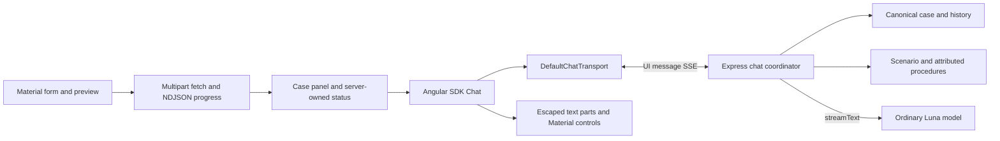

# ADR-002: Angular Material UI and Streaming Conversation

**Date:** 2026-11-06

**Status:** Proposed

**Relates to:** [Main architecture](000-main-architecture.md), [Decision assessment](001-decision-assessment.md), [PRD UI](../PRD.md#9-ui-description-wireframe-level)

## 1. Scope

An Angular Material intake form leads to an assessment/case panel and a text conversation. Reuse the official Angular AI SDK transport instead of implementing chat token parsing. Build the small Material presentation required by the PRD. No React embedding, persistent chat history, resumable streams, external messaging channels or staff UI.

## 2. Technology Documentation References

| Technology | Verified Context7 ID / official source | Purpose |
|---|---|---|
| Angular | `/websites/angular_dev`; [CLI](https://angular.dev/cli/new), [security](https://angular.dev/best-practices/security) | Standalone forms, signals, safe rendering |
| Angular Material | `/angular/components`; [theming](https://material.angular.dev/guide/theming), [installation](https://github.com/angular/components/blob/main/guides/getting-started.md) | Forms, cards, progress, dialog, typography/theme |
| AI SDK | `/vercel/ai/ai_7.0.0`; [Angular quickstart](https://ai-sdk.dev/docs/getting-started/angular), [Angular adapter](https://github.com/vercel/ai/blob/main/packages/angular/README.md) | Signal-based `Chat` and shared HTTP transport |
| SDK 7 migration | [Migration guide](https://ai-sdk.dev/docs/migration-guides/migration-guide-7-0) | Current stream helpers, instructions and completion callbacks |
| Streaming contracts | [Protocol](https://ai-sdk.dev/docs/ai-sdk-ui/stream-protocol), [custom data](https://ai-sdk.dev/docs/ai-sdk-ui/streaming-data), [Node response bridge](https://ai-sdk.dev/docs/reference/ai-sdk-ui/pipe-ui-message-stream-to-response) | SSE, message parts and case status events |
| Server history | [Persistence pattern](https://ai-sdk.dev/docs/ai-sdk-ui/chatbot-message-persistence), [resume requirements](https://ai-sdk.dev/docs/ai-sdk-ui/chatbot-resume-streams) | Canonical history and why resume is excluded |
| Alternative Angular UI kit | `/hassantayyab/angular-ai-kit`; [repository](https://github.com/hassantayyab/angular-ai-kit) | Compared component approach |

Checked on 2026-11-06. Some indexed snippets and the Angular package README still describe SDK 6. Use SDK 7's versioned sources/migration guide and the verified installed tuple, not those stale snippets.

## 3. Starter and component comparison

The research located concrete reusable starters/components, then inspected manifests and stream/UI source where available. No inspected repository was verified to preassemble Angular, actual Angular Material, AI SDK streaming and the complete chat UI together. The recommendation composes verified pieces; it does not call that combination a turnkey template.

| Candidate | Verified reusable functionality | Gap for this PRD | Decision |
|---|---|---|---|
| [Vercel Angular example](https://github.com/vercel/ai/tree/main/examples/angular) and [quickstart](https://ai-sdk.dev/docs/getting-started/angular) | Angular `Chat`, Express stream route and development proxy; source demonstrates the stream end-to-end | Plain HTML UI; workspace package references; example Angular/TS version mismatch noted in ADR-000 | Selected transport/backend boilerplate; initialize with Angular CLI and Material |
| [LocalNook AI](https://github.com/kereszteszsolt/local-nook-ai) | Complete Angular Material chat, token streaming, stop/regenerate, Markdown; Apache-2.0 repository | Ollama/browser transport, no AI SDK or separate backend; history/settings exceed PRD; Angular 20 source | Strong Material UI reference, expensive base migration for this small PoC |
| [ngx-prompt-kit](https://github.com/PianoNic/ngx-prompt-kit) | Angular chat/composer/response component sources and schematic; MIT repository | Tailwind/Spartan, no verified AI SDK transport binding or Material | Component reference only; avoid a second visual system |
| [Angular AI Kit](https://github.com/hassantayyab/angular-ai-kit) | Angular message/response components and streaming-state input | Tailwind-based; SDK binding, current published peers and sanitizer behavior not verified | Do not make it the implementation baseline |
| [Vercel AI Elements](https://github.com/vercel/ai-elements) | Ready chat presentation components | React/shadcn/Tailwind rather than Angular/Material | Design/interaction reference only |
| [assistant-ui](https://www.assistant-ui.com/docs/architecture) | React runtime and chat components | React context and component stack; no verified Angular integration in consulted docs | No React runtime in this application |

**Decision record:** **Status:** Proposed. **Date:** 2026-11-06. **Context:** The user requires Angular Material and working SDK streaming from an empty app. **Decision:** Use the first-party Angular/Express quickstart as the behavioral boilerplate and Angular CLI plus Material as the actual scaffold. Assemble the limited chat view from Material primitives; reuse SDK transport/state. **Rejected alternatives:** Migrating LocalNook replaces its provider architecture and removes persistence; adopting Tailwind/React kits adds another component system. **Consequences:** No chat stream parser to maintain; a small Material message/composer view still needs implementation and QA. **Review trigger:** A maintained, source-verified Material + SDK starter reduces the work without adding unsupported scope.

Material's component catalog provides the primitives, not an AI chat runtime or Markdown/stream parser. A component's `isStreaming` input alone does not establish working transport. The official example's [manifest](https://github.com/vercel/ai/blob/main/examples/angular/package.json) uses workspace references, so do not claim that copying its folder gives a standalone install. Initialization commands and compatibility gates are specified once in [ADR-000](000-main-architecture.md#7-configuration-and-initialization); do not run them before plan approval.

## 4. Components, state and rendering

| Component | Responsibilities and concrete behavior |
|---|---|
| App shell | Brand header, persistent PoC/synthetic-data notice, session-loss notice; one active case |
| Intake | Reactive form with the exact PRD choices; complaint-only required description; visible labels/errors, date pickers and focusable error summary |
| Image input | Native single-file chooser; original preview/remove/replace; client size/format feedback and authoritative server validation |
| Assessment progress | Stage label with Material progress indicator; no countdown or invented completion percentage; disables duplicate submission |
| Case panel | Immutable form, thumbnail, five results, supported percentages/unknown labels, evidence limits, source/date and authoritative status |
| Conversation | Render SDK message parts from Angular `Chat`; user/assistant text, errors and incomplete-attempt labels |
| Composer | Material textarea, send, summary and stop controls; Enter sends, Shift+Enter inserts newline; respect IME composition and pending-state lock |
| Reset dialog | Keyboard-accessible confirmation before aborting/deleting case and clearing every UI state |

Angular signals hold view state; SDK `Chat` owns transport/message status. No additional global state library is needed. The server owns assessment/review/history; browser state is a rendering cache. Render a later review change immediately from a server `data-case-status` event and reconcile with `GET /api/case` after a failed/interrupted stream. The LLM cannot supply an authoritative review flag as display text.

For this text-guidance PoC, render text parts as escaped text with preserved paragraphs and wrapping. Do not introduce a Markdown/HTML renderer merely to copy richer chatbot templates. Source links are built from the supplied procedure source register and allowlisted official URLs. Never render raw model HTML, use `bypassSecurityTrust*` on it, or treat a model-produced URL as a trusted source. This keeps the initial UI small and removes an unverified renderer/sanitizer dependency. [Angular security](https://angular.dev/best-practices/security).

Apply the existing [design guidance](../design-guidelines.md) and [tokens](../../assets/design-tokens.json): Instrument Sans, dark primary surfaces/text, blue accent, the measured neutral backgrounds/borders, spacing and radii. Configure the current Material `mat.theme`/`mat.theme-overrides` API, map tokens deliberately and inspect actual states. Do not use Material's default purple theme or introduce Tailwind/shadcn styling. Preserve the original logo's proportions and light-background usage; asset/font licensing remains a prerequisite for uses beyond the course. The source is a measured website reference, not an official brand manual. [Material theming](https://material.angular.dev/guide/theming).

Use text labels in addition to status color; preserve contrast, visible focus and keyboard access. Keep message growth and progress announcements polite rather than reading every token aloud. Test long Polish text, narrow desktop windows and a keyboard-only journey.

## 5. Streaming and model contracts

### Current Angular client and SDK 7 server

React `useChat` is not an Angular API. Use `Chat` from `@ai-sdk/angular`, its signal-backed messages/status/error, `sendMessage`, `stop` and supported retry methods with `DefaultChatTransport` from `ai`. The default transport posts JSON to `/api/chat` and consumes the standard UI message stream. Render `message.parts`, not an assumed single `content` string. [Angular adapter](https://github.com/vercel/ai/blob/main/packages/angular/README.md), [shared transport source](https://github.com/vercel/ai/blob/main/packages/ai/src/ui/http-chat-transport.ts).

The backend loads the trusted case and history, converts validated UI messages with `await convertToModelMessages`, and invokes `streamText` using the ordinary OpenRouter language model. In SDK 7, use top-level `instructions`, `result.stream`, `toUIMessageStream`, and Node `pipeUIMessageStreamToResponse` (or Fetch `createUIMessageStreamResponse` for an appropriate adapter). SDK Core server completion uses `onEnd`; its older `onFinish` and `system` examples may be deprecated. Angular `Chat` client callbacks are a separate surface and still document `onFinish`; do not mechanically rename them. Pin the installed version and typecheck the selected APIs. [Migration guide](https://ai-sdk.dev/docs/migration-guides/migration-guide-7-0), [Express example](https://ai-sdk.dev/cookbook/api-servers/express).

The browser receives SSE with `Content-Type: text/event-stream` and `x-vercel-ai-ui-message-stream: v1`, SDK JSON chunks and its documented stream termination. This is not raw OpenRouter SSE. Let the Angular SDK transport parse it. The separate multipart assessment endpoint uses the application NDJSON contract in ADR-000 and browser `fetch`; do not send multipart through the JSON chat transport.

### First assistant, full context and follow-ups

The first request uses the real form submission as an intake user message tagged with typed metadata `origin:intake`. Display that submitted content in the case panel rather than a duplicated chat bubble; the first visible conversation bubble is the generated assistant. Use supported `sendMessage` input with real submitted facts. Do not fabricate a user greeting, seed a fake generated answer, rely on `regenerate` with empty history, or use the undocumented null-message continuation path as an application bootstrap API. Message metadata is not converted into model context automatically; the server loads/serializes the actual saved intake. [Chat source](https://github.com/vercel/ai/blob/main/packages/ai/src/ui/chat.ts), [message conversion](https://github.com/vercel/ai/blob/main/packages/ai/src/ui/convert-to-model-messages.ts).

Every generation receives immutable form, five observations/probabilities, processing/evidence limits, escalation output, deterministic findings, selected attributed procedure content and review state. The initial generation has no prior assistant response. Later generations add the full canonical history, including the first completed answer exactly once. Return and complaint scenarios have separate instruction artifacts and procedure documents with source/date/scope. No internet browsing or RAG occurs in chat. If the complete required context no longer fits or is unavailable, report the limit and suggest a new case/review; do not silently truncate.

Only the newly submitted text and approved turn identifiers are accepted from the browser. Ignore client-supplied assistant history, replacement form, review flag, model and instructions. The only permitted case-changing model tool can add a review reason for a material correction, conflict or unsupported request; it cannot clear review, replace original facts or call either assessment stage. Validate tool input and apply the monotone domain transition before sending a status data event. Generated text cannot override the panel.

The first message contains the six PRD elements, including preliminary status, evidence/limitations, next steps and no-submission notice. Follow-ups and summaries retain full context and source sections. Business questions request entity type/professional purpose, never identifying records. A request to change scenario or image requires a new case.

### Errors, partial streams and retries

Accept a user turn once, track the generation attempt separately, and store streamed assistant parts in memory as partial until completion. On provider failure or cancellation, retain the structured assessment and mark output explicitly incomplete/failed. If no assistant output arrived, show the structured fallback rather than a blank panel or fake generated success. Chat failure never clears an existing review requirement. Before headers, return a sanitized application error; after headers, map stream errors to approved Polish text such as `Nie udało się wygenerować odpowiedzi. Wynik oceny pozostaje dostępny.` Never forward raw provider exceptions through the stream's `onError` mapping; retain redacted technical details server-side.

Retry uses the saved input for the failed turn and repeats only that assistant generation. The canonical prefix excludes the failed answer as a completed response; the failed partial remains a labeled attempt, available in the UI/history record. `Chat.regenerate` removes the corresponding assistant message when retry starts, so preserve its incomplete snapshot separately for display. For an initial failure before any assistant exists, reset the client to the saved initial prefix and use the same supported intake request path; do not call `regenerate` on an empty history. The server's operation/turn IDs prevent duplicate user turns and never restart image assessment.

Stop/response disconnect must drive an Express-side AbortController passed as the provider's `abortSignal`. Accumulate partial state during streaming and finalize cancellation independently of successful completion. The SDK documents an abort trap: `toUIMessageStream` completion may not run unless its SSE is consumed, so configure the Node bridge's `consumeSseStream`/`consumeStream` handling and test actual disconnect behavior; do not rely solely on `onEnd` for partial-history retention. Refresh ends this session. Do not enable `resumeStream`, Redis or a reconnect route: resumability requires extra persisted infrastructure. [Abort handling](https://ai-sdk.dev/docs/troubleshooting/stream-abort-handling), [resumption requirements](https://ai-sdk.dev/docs/ai-sdk-ui/chatbot-resume-streams).

## 6. Diagrams



```mermaid
sequenceDiagram
    actor Customer
    participant UI as Angular Chat
    participant BE as Chat coordinator
    participant S as Case store
    participant L as OpenRouter Luna
    Customer->>UI: Assessment completed; start guidance
    UI->>BE: Intake intent, case token and operation ID
    BE->>S: Load submitted case and recognize intake once
    BE->>L: Scenario instructions and trusted full context
    L-->>BE: Streaming assistant parts
    BE-->>UI: Standard UI message SSE
    BE->>S: Complete first answer or record failed partial
    Customer->>UI: Follow-up or summary
    UI->>BE: New text and turn ID
    BE->>S: Load all prior accepted context
    BE->>L: streamText without new assessment
    opt Material correction or conflict
        BE->>S: Add review reason through validated tool
        BE-->>UI: Authoritative case-status data event
    end
    alt Generation completes
        BE-->>UI: Final assistant message
    else Provider fails
        BE-->>UI: Error, incomplete marker; retain panel
        Customer->>UI: Retry failed response
        UI->>BE: Same turn, new attempt
        BE->>L: Saved input; chat only
    end
    Customer->>UI: Confirm new case
    UI->>BE: Cancel and delete case
    UI->>UI: Clear form, image, history and token
```

## 7. Testing and technical acceptance

Use TDD for validators, components, server history and stream behavior. Real accepted OpenRouter requests/responses must precede every provider-mock creation/refresh; include real streaming bytes/headers and multimodal inputs in safe capture provenance. Only then may AI SDK `MockLanguageModelV4` and stream helpers reproduce captured behavior in unit/integration tests. Their availability is not permission to invent an unverified protocol. Integration runs real application routes/store and mocks only external model APIs.

| Scenario | Verification |
|---|---|
| Intake conditional validation, image preview/replacement, date errors | Component tests and actual keyboard form flow; retain other fields |
| First assistant from form submission | Real SDK transport; first visible message is assistant, with actual case context and all six PRD elements |
| Follow-up/summary references earlier details | Real model E2E and manual QA; no context reset or repeated assessment |
| Stream fragments, status data, empty response, error before/after first chunk | Capture-derived integration; live smoke observes real streaming/error behavior |
| Forged assistant/context/status, conflicting user corrections | Real server validation, monotone status tests and injection cases |
| Retry with/without an assistant partial; duplicate send; stop | One accepted user turn, labeled partial, no repeated assessment; server enforces locks |
| Confirm/cancel reset; refresh; second tab | No accidental clearing before confirmation; no restored/shared case |

- TAC-002-01: The Angular adapter consumes the real backend UI message stream; its version/peer compatibility is proven by installation, typecheck and live smoke, not README claims alone.
- TAC-002-02: Case panel/status is correct even if chat is unavailable; review remains visible after every message, retry, summary and stream error.
- TAC-002-03: No raw model HTML, unrestricted links, client-side provider SDK/key, React runtime or extra UI theme is introduced.
- TAC-002-04: Playwright E2E and manual QA use real OpenRouter Decisions, escalation and chat endpoints without interception, stubs or mocked responses. Capture scripts/tests impose no artificial spend or call-count caps.
- TAC-002-05: Record successful startup separately from build/tests; capture and inspect intake, progress, chat, review, error/partial and reset states under `docs/qa/`, plus browser/server errors and network evidence.
- TAC-002-06: Inspect screenshots against the existing x-kom reference/tokens, Polish text, focus/keyboard behavior and long-text layout. Fix introduced errors/warnings before committing; missing real prerequisites leave runtime verification incomplete.
