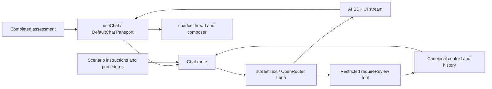

# ADR-002: Streaming Conversation and Customer UI

**Date:** 2026-11-05
**Status:** Proposed
**Relates to:** [Main architecture](000-main-architecture.md), [Assessment](001-decision-assessment.md), [PRD](../PRD.md)

## 1. Scope

Customer form-to-chat UI, first assistant message, full-history conversation, streamed failures and reset. No staff interface, database, RAG, frontend tools or external business actions.

## 2. Technology Documentation References

| Technology | Verified Context7 ID | Primary reference |
|---|---|---|
| AI SDK Core/UI | `/vercel/ai`; baseline `/vercel/ai/ai_7.0.0` | [Chatbot](https://ai-sdk.dev/docs/ai-sdk-ui/chatbot), [useChat](https://ai-sdk.dev/docs/reference/ai-sdk-ui/use-chat), [migration](https://ai-sdk.dev/docs/migration-guides/migration-guide-7-0), [tool usage](https://ai-sdk.dev/docs/ai-sdk-ui/chatbot-tool-usage), [testing](https://ai-sdk.dev/docs/ai-sdk-core/testing) |
| OpenRouter provider | `/websites/openrouter_ai`, `/openrouterteam/docs` | [Guide](https://openrouter.ai/docs/guides/community/vercel-ai-sdk), [source](https://github.com/OpenRouterTeam/ai-sdk-provider) |
| Luna | [Model page](https://openrouter.ai/openai/gpt-6-luna) | [Public catalog](https://openrouter.ai/api/v1/models) confirms text/image input, tool calling and structured outputs |
| Tailwind | `/tailwindlabs/tailwindcss.com` | [Next.js setup](https://tailwindcss.com/docs/installation/framework-guides/nextjs) |
| shadcn/ui | `/shadcn-ui/ui` | [Migration](https://ui.shadcn.com/docs/ai-elements), [Chat](https://ui.shadcn.com/docs/ai-elements/base/chat), [Message](https://ui.shadcn.com/docs/ai-elements/base/message), [Prompt Input](https://ui.shadcn.com/docs/ai-elements/base/prompt-input) |
| AI Elements | `/vercel/ai-elements` | [Current project notice](https://elements.ai-sdk.dev/) |
| assistant-ui | `/assistant-ui/assistant-ui` | [SDK v7 integration](https://www.assistant-ui.com/docs/runtimes/ai-sdk/v7) |

The OpenRouter guide includes older-style examples; use current AI SDK 7 documentation for stream/schema APIs instead of copying deprecated fields.

## 3. Component Design and UI Decision

**Status:** Proposed. **Date:** 2026-11-05.
**Context:** One streaming thread and custom assessment panel need reusable presentation, not a full chat product.
**Decision:** Current shadcn/ui Chat components: Message Scroller, Message, Bubble and Input Group, driven directly by AI SDK `useChat`. Use only necessary form/status primitives and existing x-kom tokens.
**Rejected alternatives:** Legacy AI Elements advertises deprecation at the end of November 2026 and directs new projects to shadcn/ui. Its older Conversation/Message/PromptInput composition remains a useful reference. assistant-ui explicitly supports AI SDK 7/React SDK 4, `useChatRuntime`, custom `AssistantChatTransport`, and wrapping an existing hook with `useAISDKRuntime`; it is viable but adds a runtime layer unnecessary for this single thread. A complete chatbot template adds excluded features.
**Consequences:** (+) Streaming-aware scrolling and reusable UI without another history owner. (-) Form, panel and state wiring remain application work.
**Review trigger:** Managed threads, richer tool UI, chat attachments or multiple runtimes become requirements.

The shadcn examples include scripted `createChat` helpers. **Do not use demo transports or scripted responses.** Wire these components to the real local backend. Presentation components do not perform inference or policy routing.

| Component | Owns |
|---|---|
| Intake form | PRD fields, conditional description, single-image preview and field errors |
| Progress display | Actual server stages from assessment NDJSON; no timer or invented percentage |
| Chat shell | First assistant stream, text follow-ups, incomplete/error state |
| Case panel | Read-only intake/image, five observations, probabilities, limitations and status |
| Review notice | Persistent Polish status; explicitly no staff transfer |
| Summary/reset | Summary turn or confirmed case deletion and empty form |

React owns form/preview/tab-local capability; `useChat` owns streaming display. The server owns canonical accepted history and status. Avoid browser persistence, a global store and a second conversation runtime. Tailwind 4 uses its dedicated PostCSS plugin and CSS theme variables; map existing brand tokens rather than copying Tailwind 3 setup. Preserve labels, keyboard access, focus behavior and Polish text.

## 4. Data Structures

- **ChatRequest:** case capability, `initial`/`message`/`retry` operation, request ID, optional current user text/ID. No artificial visible customer message for initial generation.
- **ServerContext:** immutable intake, initial probabilities, optional escalation evidence, deterministic findings, source/version metadata, sticky review reasons, first response and full accepted conversation.
- **UIMessage:** SDK IDs, roles and parts. Render text parts rather than an obsolete single `content` field; preserve internal tool parts for context while presenting their effect as a status update.
- **Turn state:** submitted, streaming, completed, failed/partial or aborted. An interrupted answer cannot become a successful canonical recommendation.
- **Status metadata:** server-authored stream data/metadata updates the case panel; model text cannot replace its enum.

Local resource limits: model name 200 characters, description 4,000, chat message 4,000. Explain oversized inputs. Before each call verify the full context fits the configured model budget with an output reserve; report exhaustion and require a new case instead of silently truncating or summarizing away evidence/history. Retain visible context until reset.

## 5. Interface Contracts and Streaming

### Model/protocol

Use `createOpenRouter` with server configuration and an explicit Luna chat model instance. `streamText` performs ordinary inference through OpenRouter chat completions. Do not pass a bare model string and unintentionally resolve through Vercel AI Gateway.

For SDK 7 use `result.stream`, `toUIMessageStream` and `createUIMessageStreamResponse`. Await `convertToModelMessages` on canonical turns. Prefer `instructions`; the old chained response helper and `system` path are deprecated. Set automatic retries to zero and propagate cancellation.

The browser uses `useChat` from `@ai-sdk/react`, `DefaultChatTransport` and `sendMessage`. Customize `prepareSendMessagesRequest` to send the case capability and current user delta only; the server reconstructs history. The local route returns the AI SDK UI message SSE protocol, not raw OpenRouter deltas, plain text or assessment NDJSON.

### First response

After assessment completes, mount an empty chat and call `sendMessage` without adding a message, carrying operation `initial`. The documented optional argument resubmits current messages. The backend uses the assessed case as trusted initial context and streams the first assistant bubble. Verify empty-transcript behavior against the pinned SDK during implementation.

Stable request IDs and a case lock prevent remount/double-click duplication. A duplicate completed initial operation returns the actual canonical response through the UI protocol without another provider call. This deduplicates a real result; it is not a fixture provider. A failed first response retries only explanation generation.

The first bubble combines a code-owned greeting/status/limitations wrapper with the real streamed explanation, sources and next steps. Its six required content elements come from PRD Section 11.5. If generation fails, show known structured facts and an explicitly non-generated failure notice; do not present canned text as successful inference.

### Follow-ups and review

Serialize operations and accept each user request ID once. Commit the assistant turn only on successful stream completion. On interruption retain the user turn, mark the assistant partial and let retry replace that partial; never duplicate the user message or rerun image assessment.

One internal server tool, `requireReview`, may **add** a validated reason to the current case. It accepts a fixed reason enum (material correction, conflicting information, unsupported request, insufficient context) and a reference to the current user turn; the case ID is server-bound, not supplied by the model. It cannot clear review, edit the original form, rerun Decisions, approve a remedy, contact staff or perform an external action. Ordinary questions do not require review merely for being follow-ups. Scenario instructions require this tool before explaining a material correction or new conflict.

Use the current SDK `tool` contract with `inputSchema` and server `execute`. Permit at most two steps per customer turn using the current `isStepCount` condition: one tool-bearing model step and one explanatory continuation; constrain tool calls to one per turn. Preserve tool result and original observations in canonical history. If the tool fails or the bounded continuation cannot complete, set review required in code and show failure. This does not invoke the initial decision model again. Natural-language recognition of corrections remains model-dependent; verify it with explicit evaluation cases rather than claiming formal detection guarantees.

The server validates and monotonically accumulates review reasons. No API or tool clears them. Every later model request receives the current status. The visible authoritative label stays code-owned even if generated prose is contradictory; such prose is a quality failure to fix, never a business command.

### Timeouts, errors and trust

Set a 60-second total chat deadline. Pre-header failure returns a sanitized HTTP error; post-header failure uses SDK stream error/failed outcome. Keep incomplete text visibly labeled, retain the panel/status, and retry only the failed explanation. Never commit empty partial text as successful completion.

Customer text and text embedded in images are untrusted data. Do not forward frontend system prompts or tools from examples. The chat has no image-analysis tool or business-action capability. System instructions separate policy facts, deterministic findings, visual judgments and customer statements. Prompt compliance and grounded language remain evaluation concerns; a valid stream does not prove factual correctness.

### Procedure and scenario artifacts

Later implementation creates two versioned procedure documents and two separate scenario instruction files in the server module. Return content follows the PRD's sourced rules/exceptions; complaint content follows its non-conformity guidance. Record source dates and hashes, pin the session's version, and select instructions from the submitted request type. No fictional terms, runtime web research or RAG. Switching request type starts a new case.

## 6. Diagrams

### Components/data flow



### Initial and continuing chat

```mermaid
sequenceDiagram
    participant B as Browser
    participant C as Chat route
    participant S as Case store
    participant L as Luna
    B->>C: initial; no visible user message
    C->>S: Lock and read assessment/sources
    C->>L: Trusted initial context
    L-->>C: Live deltas
    C-->>B: First assistant UI stream
    C->>S: Commit complete response
    B->>C: Follow-up and request ID
    C->>L: Full canonical history and evidence
    opt Material correction or conflict
        L->>C: requireReview
        C->>S: Add reason; cannot clear status
        C-->>L: Current mandatory review state
    end
    L-->>C: Live explanation
    C-->>B: Stream and authoritative status
    C->>S: Commit complete response
```

### Failure/retry

```mermaid
sequenceDiagram
    participant B as Browser
    participant C as Chat route
    participant L as Luna
    B->>C: Initial or follow-up turn
    C->>L: Real stream request
    L-->>C: Partial text then failure
    C-->>B: Incomplete response and stream error
    C->>C: Retain context/status; do not commit success
    B->>C: Retry failed operation
    C->>L: Same canonical context; replace partial answer
    Note over B,L: No repeat Decisions or image escalation
```

## 7. Testing Strategy

Use Red -> Green -> Refactor. Unit/integration chat tests use `MockLanguageModelV4` from `ai/test` and `simulateReadableStream` from `ai`, confirmed through versioned Context7. No mock flag, demo transport or scripted fallback enters the app.

| Scenario | Layer | Expected evidence |
|---|---|---|
| First assistant without visible user turn | Integration/real E2E | Starts once; six PRD elements present |
| True streaming | Integration/real E2E | Intermediate text rendered before completion |
| Full context recalled | Integration/real E2E | Follow-up uses form, initial/escalated evidence and first reply |
| Forged prompt/status/history/tool | Integration | Rejected; canonical state unaffected |
| Duplicate initial/send/retry | Integration | One accepted user turn/complete answer per operation |
| Partial failure/abort | Unit/integration | Incomplete label; retry without assessment repetition |
| Correction, conflict or unsupported new request | Integration/live evaluation | Restricted tool adds review before explanation; never clears it |
| Ordinary procedural question | Integration/real E2E | Answer uses history; no unnecessary review flag solely because a question was sent |
| Business buyer or demand to clear review | Integration/real E2E | Clarifying questions continue; no removal or fake handoff |
| Injection, invented damage or approval promise | Live evaluation/manual QA | Respect evidence/status boundaries; report content failures |
| Refresh/reset/expired case | Integration/real E2E | No recovery or cross-case leakage |
| Polish UI, keyboard, brand and errors | Manual browser | Screenshots, no console errors, comparison with project design guidance |

Live Luna smoke: actual streamed first explanation, then a context-dependent follow-up. Pair it with ADR-001's real Decisions and escalation smoke checks. Manual/E2E always use the real stack/models. Deterministic outage simulations belong only to unit/integration tests; actual live failures are not mocked into success.

- TAC-002-01: UI consumes the SDK protocol and displays real partial text before completion.
- TAC-002-02: No scripted/demo provider or fixture is used in application/manual/E2E flows.
- TAC-002-03: Initial generation needs no artificial visible user bubble.
- TAC-002-04: First response and accepted conversation remain available to follow-ups.
- TAC-002-05: Client edits, model replies, retries and new information cannot clear review.
- TAC-002-06: Failed partial responses are never committed as complete recommendations.
- TAC-002-07: Startup, live smoke, E2E and manual screenshots are separate evidence.
